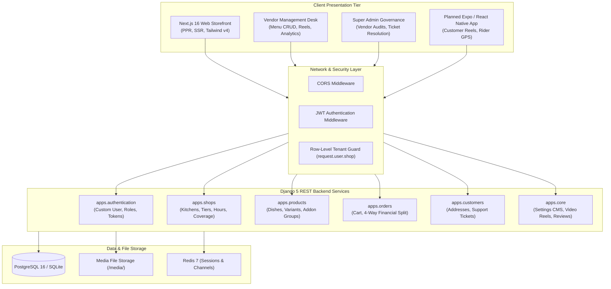
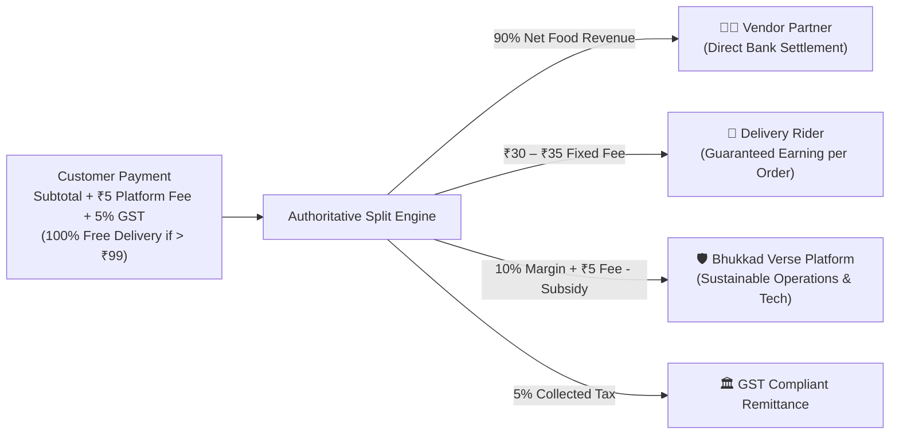
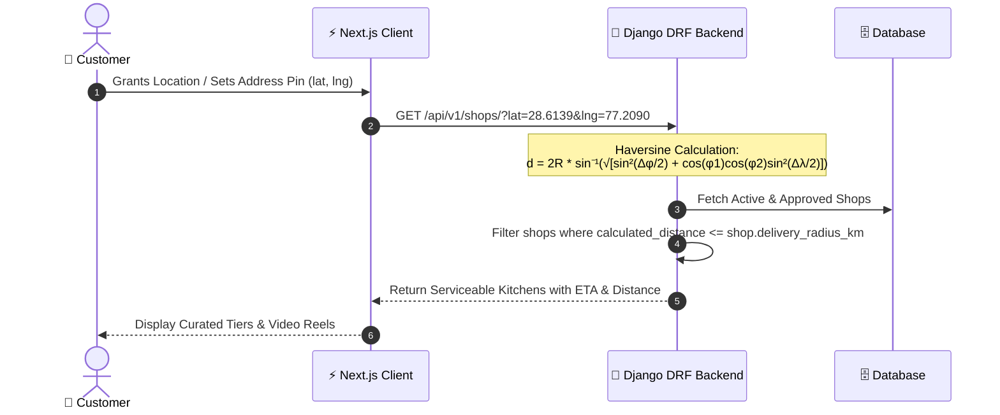

# System Architecture — Bhukkad Verse
> **Analysis Date:** October 2026  
> **Source:** `docs/FOODHUB_ARCHITECTURE_PLAN.md`, `docs/PROJECT_REPORT.md`, `backend/apps/`, `frontend/src/`

---

## 🏛️ High-Level System Architecture

Bhukkad Verse operates as a decoupled client-server architecture with strict separation between user-facing presentation, business logic orchestration, and relational persistence.

---

## 💰 4-Way Fair Real-World Economics Model

Unlike conventional food aggregators that take 25%–35% cuts and impose multi-layered fees on customers, Bhukkad Verse implements an immutable 4-way economic split:

### Calculation Example (₹399 Order)
1. **Food Subtotal:** ₹399.00
2. **Delivery Fee:** ₹0.00 (Waived via 100% Free Delivery promotion on orders > ₹99)
3. **Platform Fee:** ₹5.00
4. **GST (5%):** ₹19.95
5. **Customer Grand Total:** ₹423.95 (Zero bill shock; saves ₹25+ vs Swiggy/Zomato)
6. **Vendor Net Payout:** ₹359.10 (90% of ₹399)
7. **Rider Guaranteed Payout:** ₹32.00
8. **Platform Net Margin:** ₹42.85

---

## 📍 Geospatial Discovery & Serviceability

---

## 🔐 Multi-Tenant Row-Level Isolation

To ensure absolute privacy and security among competing kitchen partners:
- The `Shop` model acts as the tenant root for all product catalogs.
- `request.user.shop` binds vendor operations.
- All vendor viewsets (`VendorProductViewSet`, `VendorCategoryViewSet`, `VendorOrderViewSet`) override `get_queryset()` to constrain access to the active shop.
- Attempts to inspect or modify another vendor's products or orders result in an immediate `HTTP 403 Forbidden` or `HTTP 404 Not Found`.

