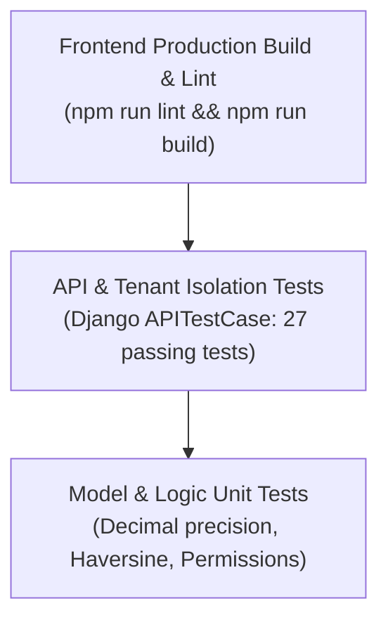

# Testing Strategy & Verification Guide — Bhukkad Verse
> **Analysis Date:** October 2026  
> **Source:** `backend/apps/*/tests.py`, `.github/workflows/`

---

## 🧪 Testing Pyramid & Structure

The repository uses automated test suites across both backend and frontend layers:



---

## 🏃 Test Execution Commands

### 1. Backend Automated Test Suite
The backend utilizes Django REST Framework's `APITestCase`:

```bash
# Run all backend tests
cd backend
python manage.py test apps --verbosity=2

# Run specific app tests
python manage.py test apps.authentication.tests
python manage.py test apps.shops.tests
python manage.py test apps.products.tests
python manage.py test apps.customers.tests

# Run a specific test class
python manage.py test apps.products.tests.ProductCatalogTests.test_cross_vendor_category_access_forbidden
```

### 2. Frontend Build & Static Verification
```bash
cd frontend

# Verify TypeScript compilation and ESLint rules
npm run lint

# Verify full static generation and Partial Prerendering (PPR)
npm run build
```

---

## 🔍 Key Test Scenarios Covered

1. **Authentication & Token Lifecycle (`apps.authentication.tests`):**
   - User registration with unique phone and email.
   - JWT access token generation and refresh token rotation.
   - `/api/v1/auth/me/` retrieval of user roles and profile details.

2. **Shop Lifecycle & Security (`apps.shops.tests`):**
   - Shop creation transitioning to `PENDING`.
   - Admin approval transition to `APPROVED`.
   - Verification that unapproved shops are excluded from customer-facing discovery.

3. **Vendor Multi-Tenant Isolation (`apps.products.tests`):**
   - Vendor A attempting to access Vendor B's categories is blocked with HTTP 403 / 404.
   - Assignment of Vendor B's category to Vendor A's product is rejected.
   - Prevention of negative or zero prices on dishes and size variants.
   - Decimal monetary precision validation.

---

## 💡 Mocking & Test Isolation Guidelines

- **Database:** Unit tests execute against an isolated in-memory SQLite test database created automatically by Django runner (`test_db.sqlite3`).
- **External Maps / Payment APIs:** External HTTP calls to Razorpay or Google Maps should be mocked using Python's `unittest.mock.patch` or `responses` library.

