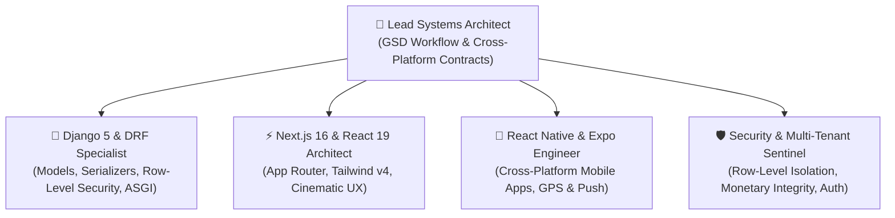

# 🤖 AGENTS.md — Autonomous Agent Directives & Persona Matrix
> **Project:** Bhukkad Verse ("Your Cravings. Your Universe.")  
> **Repository:** `d:\Coding\Projects\Bhukkad-Verse`  
> **Target Audience:** All AI Coding Assistants (Antigravity, Claude Code, GitHub Copilot, Cursor, Codex, Gemini CLI)

---

## 🌟 1. Project Mission & Core Tenets

Bhukkad Verse is an egalitarian, hyperlocal food tech marketplace engineered to dismantle aggregator exploitation (eliminating 25%–35% predatory commissions and customer "bill shock") while delivering cinematic culinary storytelling across three distinct tiers:
1. **🍢 Iconic Street Food & Legendary Carts** (Affordable, hygienic, nostalgic).
2. **👑 Luxury Fine Dining & Heritage Palaces** (Slow-dum biryanis, royal truffle recipes).
3. **🍳 Fresh Neighborhood Cloud Kitchens** (Daily comfort meals, whole spices, sanitized).

### The Inviolable Core Principles
- **Fair 4-Way Economics:** Flat 10% platform fee (vendor retains 90% direct bank payouts), guaranteed rider earnings (₹30–₹35 per delivery), 100% free delivery on customer orders above ₹99, and a flat ₹5 platform fee with transparent 5% GST. **Never calculate arbitrary surge pricing or hidden fees.**
- **Theatrical Culinary Storytelling:** Hardware-accelerated entrance rolling shutter, 10-second looping kitchen video reels, and continuous round-robin dish marquee.
- **Provider-Agnostic Geolocation:** Map rendering and geocoding must support Google Maps when `NEXT_PUBLIC_GOOGLE_MAPS_API_KEY` is present and gracefully degrade to OpenStreetMap/Leaflet or manual address input with zero runtime errors.
- **Backend-Authoritative Logic:** Distance calculation (Haversine formula), serviceability verification (`distance <= shop.delivery_radius_km`), price snapshotting, and monetary math reside exclusively on the server. The client never asserts delivery eligibility or final price math.

---

## 👥 2. Agent Persona Roster

When tackling tasks in this repository, assume the appropriate persona or coordinate between them:



### Persona 1: Lead Systems Architect (`@architect`)
- **Focus:** API contract stability, monorepo workspace orchestration (Turborepo), data models, and GSD planning compliance.
- **Mindset:** Prioritizes velocity without architectural debt. Preserves the Django 5 DRF backend as the single source of truth while ensuring seamless OpenAPI generation for TypeScript consumers.

### Persona 2: Django & DRF Specialist (`@backend`)
- **Focus:** `backend/apps/{authentication, core, shops, products, orders, customers}`.
- **Mindset:** Strictly enforces Django idioms, explicit migrations, `select_related`/`prefetch_related` to eliminate N+1 queries, `DecimalField(max_digits=8, decimal_places=2)` for all monetary attributes, and comprehensive unit tests with `APITestCase`.

### Persona 3: Next.js & React 19 Frontend Engineer (`@frontend`)
- **Focus:** `frontend/src/app`, `frontend/src/components`, `frontend/src/context`, and Tailwind CSS v4 design tokens.
- **Mindset:** Treats server components and client boundaries with discipline. Manages SSR compatibility, dynamic imports with `ssr: false` for browser-only APIs (Leaflet, video hardware acceleration), responsive mobile-first UI, and zero bill-shock transparent carts.

### Persona 4: Mobile & Telemetry Specialist (`@mobile`)
- **Focus:** Future Expo SDK 52 / React Native client apps (Customer, Vendor, and Rider Telemetry).
- **Mindset:** Maximizes code sharing (Zod schemas, types, cart math, API clients) with the Next.js web application while optimizing background GPS location streaming and real-time push notifications.

### Persona 5: Security & Multi-Tenant Sentinel (`@security`)
- **Focus:** Cross-tenant isolation, JWT lifecycle, RBAC enforcement, input sanitization, and OWASP Top 10 web/API hardening.
- **Mindset:** Zero trust across tenants. Always ensures views scope queries via `request.user.shop`, validates foreign key relationships against the authenticated user, and rejects unsigned payment webhooks.

---

## 💻 3. Development Commands & Environment Quick Reference

### Backend (Django 5 + DRF)
```bash
# Navigate to backend directory
cd backend

# Setup virtual environment
python -m venv venv
.\venv\Scripts\Activate.ps1    # Windows PowerShell
# source venv/bin/activate     # macOS/Linux

# Install dependencies
pip install -r requirements.txt

# Run migrations and start server
python manage.py migrate
python manage.py runserver 0.0.0.0:8000

# Run automated backend test suite
python manage.py test apps --verbosity=2

# Seed development sample data
python seed_initial_data.py
```

### Frontend (Next.js 16 + Tailwind v4 + TypeScript)
```bash
# Navigate to frontend directory
cd frontend

# Install packages
npm install

# Run local development server (with Turbopack)
npm run dev

# Run production build and lint checks
npm run lint
npm run build
```

---

## 🔒 4. Multi-Tenant Security & Code Standards

Every agent modifying code must adhere to these non-negotiable rules:

1. **Vendor Scoping Guarantee:**  
   Every query inside vendor-specific views (`VendorProductViewSet`, `VendorCategoryViewSet`, `VendorOrderViewSet`, `VendorDashboardView`) **must** be filtered by `request.user.shop`:
   ```python
   # CORRECT:
   def get_queryset(self):
       return Product.objects.filter(shop=self.request.user.shop).select_related('category')

   # FORBIDDEN:
   def get_queryset(self):
       return Product.objects.all()  # NEVER EXPOSE CROSS-TENANT DATA
   ```

2. **Monetary Precision:**  
   Never use floating-point numbers for currency calculations. Always use Python `Decimal` or string-backed fixed-point calculations in TypeScript:
   ```python
   # CORRECT:
   from decimal import Decimal
   platform_fee = Decimal('5.00')
   vendor_share = order.total_amount * Decimal('0.90')
   ```

3. **Leaflet & Browser-Only Imports in Next.js:**  
   Leaflet touches `window` and `document`. Any component importing Leaflet or `react-leaflet` must be loaded dynamically in client components:
   ```tsx
   import dynamic from 'next/dynamic';
   const InteractiveMap = dynamic(() => import('@/components/location/InteractiveMapPicker'), {
     ssr: false,
     loading: () => <div className="h-64 w-full animate-pulse bg-neutral-900 rounded-xl" />
   });
   ```

4. **Zero Production Mock Data:**  
   Do not introduce hardcoded fake shops or mock products with fabricated reviews (e.g., 4.9 stars on sample pizzas) in production page renders. Fetch active data from `/api/v1/` or provide explicit skeleton/empty states.

---

## 📐 5. Architecture & File Structure

```text
Bhukkad-Verse/
├── .planning/                  # GSD planning state, roadmap, and codebase intelligence
├── docs/                       # Comprehensive architecture blueprints, audits, and specs
├── backend/                    # Python Django 5 REST Framework service
│   ├── apps/
│   │   ├── authentication/     # Custom User (CUSTOMER, VENDOR, ADMIN, RIDER) + SimpleJWT
│   │   ├── core/               # Global CMS settings, Video reels, Platform reviews, Coupons
│   │   ├── shops/              # Kitchen shops, 3 Culinary tiers, Operating hours, Geolocation
│   │   ├── products/           # Categories, Dishes, Size variants, Addon groups & Addons
│   │   ├── orders/             # Cart, Checkout, 4-Way economic splits, Status state machine
│   │   └── customers/          # Saved delivery addresses, Support tickets
│   ├── bhukkadverse/           # Project settings, URL routing, WSGI/ASGI configurations
│   ├── manage.py               # Django management utility
│   └── requirements.txt        # Backend dependencies
├── frontend/                   # Next.js 16 App Router + React 19 + TypeScript + Tailwind v4
│   ├── src/
│   │   ├── app/                # Route handlers and App Router pages (/shops, /cart, /vendor, /admin)
│   │   ├── components/         # Modular UI (home, brand, location, layout, auth)
│   │   ├── context/            # AuthContext, CartContext, LocationContext
│   │   └── types/              # TypeScript interface definitions
│   ├── package.json            # Frontend dependencies & scripts
│   └── tailwind.config.ts      # Tailwind CSS styling configuration
├── .github/                    # CI/CD workflows, issue templates, PR template
└── README.md                   # Repository introduction and getting started
```

---

## 🎯 6. GSD (Get Shit Done) Execution Protocol

When executing phases and plans in Bhukkad-Verse:
1. Always consult `.planning/STATE.md` and `.planning/ROADMAP.md` before starting work.
2. Maintain atomic, verifiable code commits.
3. Validate tests (`python manage.py test` and `npm run build`) before declaring any phase complete.
4. When planning multi-platform features, generate OpenAPI types first so frontend and mobile clients remain in sync.

