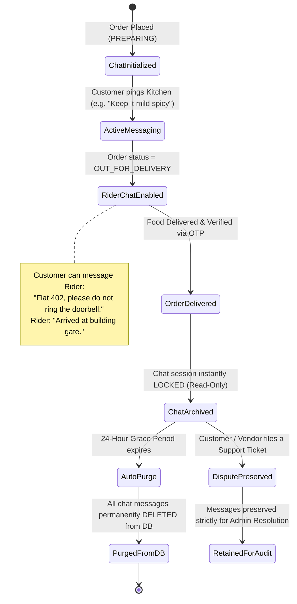
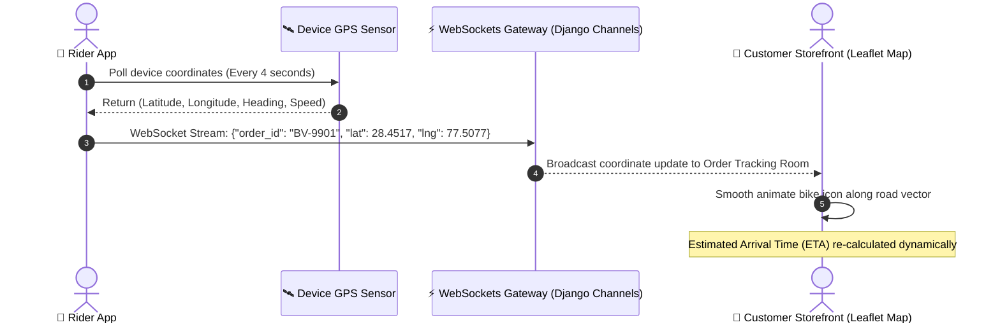
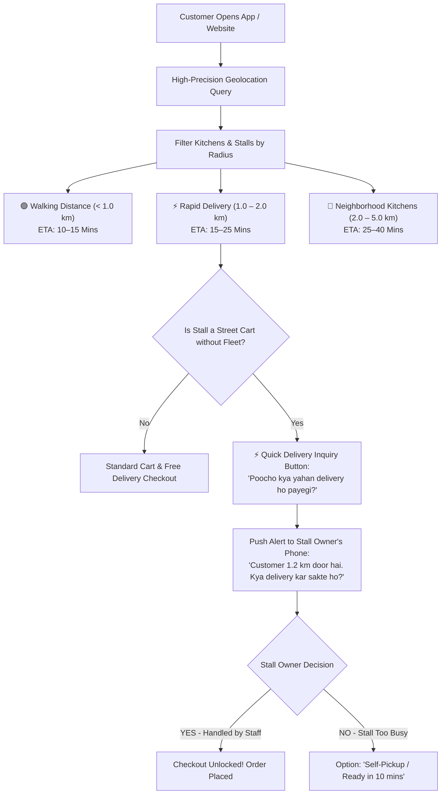
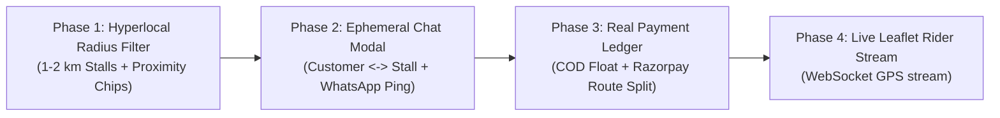

# 🚀 BHUKKAD VERSE — COMMERCIAL BLUEPRINT, MONEY-FLOW & STRATEGIC ROADMAP

> **"YOUR CRAVINGS. YOUR UNIVERSE."**  
> *A Production-Grade Architectural Framework for Hyperlocal Food Commerce, Escrow Banking Splits, Ephemeral Chat Logistics, and Zero-Budget Viral Distribution.*  
> **Prepared by:** Ayush Saxena (Lead Architect & Founder)  
> **Document Status:** Official Production Strategy & Investor/Partner Presentation Document  

---

## 📑 TABLE OF CONTENTS

1. [Executive Vision & Market Thesis](#1-executive-vision--market-thesis)
2. [Pillar 1: Banking Rails, Money Flow & COD Reconciliation](#2-pillar-1-banking-rails-money-flow--cod-reconciliation)
3. [Pillar 2: Real-Time Communication & Ephemeral Chat Lifecycle](#3-pillar-2-real-time-communication--ephemeral-chat-lifecycle)
4. [Pillar 3: Live Rider GPS Tracking Architecture](#4-pillar-3-live-rider-gps-tracking-architecture)
5. [Pillar 4: Hyperlocal 1–2 KM Radii & "Can You Deliver?" Ping Protocol](#5-pillar-4-hyperlocal-12-km-radii--can-you-deliver-ping-protocol)
6. [Database Scaling & Ephemeral Storage Strategy (PostgreSQL + Redis)](#6-database-scaling--ephemeral-storage-strategy)
7. [Pillar 5: Zero-Budget Viral Customer Acquisition Engine](#7-pillar-5-zero-budget-viral-customer-acquisition-engine)
8. [Phased Technical Implementation Sequence](#8-phased-technical-implementation-sequence)

---

## 1. EXECUTIVE VISION & MARKET THESIS

Modern food delivery apps (Zomato/Swiggy) operate as monopolistic extractive tolls:
* **Restaurants** are taxed with **25%–35% commissions**, destroying small culinary margins.
* **Customers** face "bill shock", where a ₹250 meal costs ₹380+ after layered surge fees, platform convenience fees, packaging fees, and distance charges.
* **Street food carts and local stalls** are entirely excluded due to high commission barriers and lack of dedicated delivery infrastructure.

**BHUKKAD VERSE** replaces this model with an **Egalitarian Food Marketplace**:
1. **Flat 10% Platform Fee** — Kitchens keep **90% net revenue**.
2. **100% Free Delivery on ₹99+ orders** (saving ₹25) + flat ₹5 platform fee.
3. **Theatrical Frontline** — Velvet entrance rolling shutter and 10-second kitchen video reels.
4. **Hyperlocal Cart Integration** — Inclusion of 1–2 km street food carts via smart proximity filtering and pre-order delivery inquiries.

---

## 2. PILLAR 1: BANKING RAILS, MONEY FLOW & COD RECONCILIATION

### 2.1 The 4-Way Real-World Settlement Engine

```mermaid
flowchart TD
    subgraph OrderPayment ["Customer Checkout (Example ₹399 Order)"]
        PayChoice{"Payment Method?"}
        PayChoice -->|Online UPI / Cards| OnlineGate["Razorpay Route / Cashfree Split Gateway"]
        PayChoice -->|Cash on Delivery| CODHandover["Cash Handover to Delivery Partner"]
    end

    subgraph EscrowSplit ["Automated Escrow Split (Online Gateway)"]
        OnlineGate --> Nodal["Nodal Escrow Pool\n₹423.95 (Total Paid)"]
        Nodal -->|90% Dish Value (T+1 Settlement)| VendorBank["👨‍🍳 Vendor Bank Account\n₹359.10 (Direct NEFT/IMPS)"]
        Nodal -->|Fixed Delivery Wage| RiderWallet["🛵 Rider In-App Wallet\n₹35.00 (Instant Payout)"]
        Nodal -->|10% Commission + ₹5 Fee| AdminBank["🛡️ Bhukkad Verse Current A/C\n₹44.90 (Net Platform Margin)"]
        Nodal -->|5% Food GST Remittance| TaxPool["🏛️ Tax Pool (Govt GST Portal)\n₹19.95"]
    end

    subgraph CODSettlement ["Virtual Float Settlement (COD)"]
        CODHandover --> RiderCash["Rider collects ₹423.95 Cash in Hand"]
        RiderCash --> FloatCheck{"Rider Cash Float Check\n(Limit: ₹1,500 Max)"}
        FloatCheck -->|Under Limit| DeductEarnings["Rider Wallet credited ₹35 delivery wage\nNegative cash float recorded: -₹388.95"]
        DeductEarnings --> AutoRecon["System recovers cash balance from rider's future online delivery payouts"]
        FloatCheck -->|Limit Exceeded| LockRider["Rider blocked from taking new COD orders until cash deposited via UPI"]
        AutoRecon --> PlatformPayVendor["Platform settles Vendor's ₹359.10 directly to bank via daily batch payout"]
    end
```

### 2.2 Key Banking Rules
1. **Never Hold All Marketplace Funds in a Single Personal Account:**
   * Direct customer payments must pass through **Razorpay Route** or **Cashfree Split**.
   * The payment gateway automatically disburses 90% to the vendor's verified bank account within 24 hours of successful delivery. This ensures **zero tax liability** for the platform on the vendor's 90% portion.
2. **Cash on Delivery (COD) Float & Anti-Theft Protocol:**
   * A rider cannot hoard unlimited cash. Once a rider holds **₹1,500 in physical cash**, new orders are paused until they settle the balance back to the platform via UPI.
   * If an order is cancelled at the doorstep, the item is either returned to the kitchen or logged for dispute arbitration.

---

## 3. PILLAR 2: REAL-TIME COMMUNICATION & EPHEMERAL CHAT LIFECYCLE

### 3.1 Ephemeral In-App Chat vs. Permanent Storage



### 3.2 Chat Retention Policy & Zero-Cost Architecture
* **Why NOT store chat forever?**
  Order delivery chats (*"Bhaiya gate pe call karna"*, *"Extra green chutney daal dena"*) have zero business value after the meal is eaten. Storing them permanently bloats the database, incurs unnecessary cloud storage costs, and introduces data privacy risks.
* **Production Solution:**
  1. **Lifecycle Binding:** The chat room is created on order creation and is available *only* while the order is `PREPARING` or `OUT_FOR_DELIVERY`.
  2. **Automated 24-Hour Purge (TTL):** Once an order reaches `DELIVERED`, the chat room locks into read-only mode and is purged after 24 hours by an automated Celery/Cron background task.
  3. **Zero-Cost WhatsApp Fallback Button:**
     * For users who prefer direct WhatsApp, every order card includes a **1-Tap WhatsApp Ping**:
       `https://wa.me/91XXXXXXXXXX?text=Hi%20Chef,%20regarding%20Order%20#BV-8812...`
     * 100% of this chat storage is managed by WhatsApp on their servers at **₹0 cost** to Bhukkad Verse!

---

## 4. PILLAR 3: LIVE RIDER GPS TRACKING ARCHITECTURE



### 4.1 Cost-Effective Map Technology:
* Avoid expensive Google Maps JavaScript APIs ($7–$10 per 1,000 loads).
* Use **OpenStreetMap tiles via Leaflet.js** (100% Free & Open Source) with client-side coordinate interpolation.
* Battery-optimized tracking: Rider app polls GPS only when order is active, stopping immediately upon delivery confirmation.

---

## 5. PILLAR 4: HYPERLOCAL 1–2 KM RADII & "CAN YOU DELIVER?" PING PROTOCOL

Street food carts, kathi roll stalls, and momo points often lack dedicated delivery boys. They need a custom **Hyperlocal Fast-Delivery Protocol**:



---

## 6. DATABASE SCALING & EPHEMERAL STORAGE STRATEGY

### Will SQLite $\to$ PostgreSQL Handle All Chats & Transactions?

| Component | Dev (Local) | Production (Cloud) | Scaling Assessment |
| :--- | :--- | :--- | :--- |
| **Core Entities** (Users, Shops, Menus, Orders, Invoices) | SQLite 3 | **PostgreSQL 16** | **Flawless.** PostgreSQL easily handles millions of rows, relational constraints, ACID financial transactions, and spatial queries. |
| **Live Chat Messages** (Order-specific queries) | SQLite 3 | **PostgreSQL (with 24h Purge) OR Redis Pub/Sub** | **Lightweight.** Messages are ephemeral and purged 24 hours post-delivery, keeping active DB storage under 50 MB even at 10,000 orders/day. |
| **Live Rider GPS Streams** (4s coordinate updates) | Local Memory | **Redis In-Memory Key-Value** | **Zero DB Bloat.** Coordinates are streamed live over WebSockets and NOT written to SQL disk, preventing database lockups. |

---

## 7. PILLAR 5: ZERO-BUDGET VIRAL CUSTOMER ACQUISITION ENGINE

```
┌────────────────────────────────────────────────────────────────────────┐
│                   ZERO-BUDGET VIRAL ACQUISITION ENGINE                 │
├──────────────────────────┬──────────────────────────┬──────────────────┤
│ 1. The Cart QR Standee   │ 2. Midnight Campus Wedge │ 3. Social Reels  │
├──────────────────────────┼──────────────────────────┼──────────────────┤
│ Free acrylic table stands│ Target hostel clusters   │ 10-second kitchen│
│ for partner street carts │ with late-night cravings │ reels shared on  │
│ converting standing lines│ and group cart bill      │ Instagram food   │
│ into repeat deliveries.  │ splitting discounts.     │ blogger handles. │
└──────────────────────────┴──────────────────────────┴──────────────────┘
```

### 1. The Stall Partner Infiltration (Zero Ad Spend)
* Every busy street stall has 200–400 customers daily waiting in line.
* We provide partner stalls with a sleek **Acrylic Counter Stand**:
  > *"Bhukkad Verse: Bheed me khade mat raho! Ghar baithe order karo — 100% Free Delivery on ₹99+."*
* **Why stalls comply:** The stall owner earns 90% net sales and avoids giving Swiggy a 30% cut. They willingly promote the QR code to their own customers.

### 2. The Late-Night College / Hostel Wedge
* Target student hubs (e.g. Greater Noida Knowledge Park, Delhi North Campus).
* From 11:00 PM to 3:00 AM, traditional apps charge ₹80–₹120 in surge delivery fees.
* Bhukkad Verse runs the **"Midnight Hunger Relief"** campaign: Flat ₹5 platform fee, free delivery over ₹99.
* 3 hostel student ambassadors receive weekly food credits in exchange for distributing coupons across hostel WhatsApp groups.

### 3. Automated WhatsApp Viral Receipt
* When an order is delivered:
  > *"Aapka Garam Samosa Deliver Ho Gaya! 🥟 Apne doston ke sath link share karein aur agle order par ₹25 off payein: [Referral Link]"*
* Converts a single eater into a group order.

---

## 8. PHASED TECHNICAL IMPLEMENTATION SEQUENCE



1. **Phase 1 (Immediate Next Step):** Hyperlocal 1–2 KM Radius badges (`0.8 km • 12 mins ETA`), "Walking Distance" filters, and pre-order stall delivery inquiries.
2. **Phase 2:** Ephemeral In-App Order Chat with automatic 24-hour expiration lifecycle + 1-Tap WhatsApp Direct Link.
3. **Phase 3:** Database ledger tables for Vendor T+1 Auto-Payouts and Rider Cash Float limits.
4. **Phase 4:** Live OpenStreetMap / Leaflet moving bike tracker powered by WebSockets.

---

*(Document compiled for technical review, investor pitching, and architectural execution. Licensed under MIT by Ayush Saxena.)*
