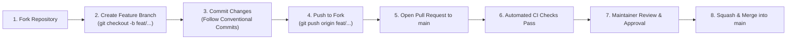

# 🤝 Contributing to BHUKKAD VERSE

First off, thank you for considering contributing to **BHUKKAD VERSE**! 🎉 

Bhukkad Verse is an open-source, next-generation hyperlocal food marketplace bridging street food carts, neighborhood cloud kitchens, and luxury fine-dining restaurants with transparent pricing and cinematic experiences.

To maintain code reliability, security, and production standards, **direct pushes to the `main` branch are strictly prohibited**. All contributions must be submitted via **Pull Requests (PR)** and pass automated validation checks before being reviewed and merged.

---

## 🔒 Code Governance & Pull Request Workflow



---

## Table of Contents

- [Code of Conduct](#code-of-conduct)
- [How Can I Contribute?](#how-can-i-contribute)
  - [Reporting Bugs](#reporting-bugs)
  - [Suggesting Enhancements](#suggesting-enhancements)
  - [Improving Documentation](#improving-documentation)
  - [Code Contributions](#code-contributions)
- [Development Setup](#development-setup)
  - [Prerequisites](#prerequisites)
  - [Fork & Clone](#fork-and-clone)
  - [Backend Setup (Django & DRF)](#backend-setup-django--drf)
  - [Frontend Setup (Next.js & Tailwind CSS)](#frontend-setup-nextjs--tailwind-css)
- [Git Workflow & Commit Guidelines](#git-workflow--commit-guidelines)
  - [Branch Naming Conventions](#branch-naming-conventions)
  - [Conventional Commits](#conventional-commits)
- [Pre-Commit Quality Checklist](#pre-commit-quality-checklist)
- [Pull Request Process](#pull-request-process)
- [Coding Standards & Linting](#coding-standards--linting)
- [Security Vulnerability Reporting](#security-vulnerability-reporting)
- [Star the Project](#star-the-project)

---

## Code of Conduct

All contributors and maintainers are expected to adhere to our [Code of Conduct](CODE_OF_CONDUCT.md). Please read it to ensure a welcoming and inclusive environment for everyone.

---

## How Can I Contribute?

### Reporting Bugs

Before creating a bug report, check existing issues to ensure it hasn't already been reported.

When creating a bug report, use our [Bug Report Form](.github/ISSUE_TEMPLATE/bug_report.yml) and provide:
- A clear, descriptive title.
- Steps to reproduce the behavior.
- Expected vs. actual behavior.
- Operating system, browser version, and environment details.
- Screenshots or console logs if applicable.

### Suggesting Enhancements

Feature requests are tracked as GitHub issues. When suggesting a feature:
- Use our [Feature Request Form](.github/ISSUE_TEMPLATE/feature_request.yml).
- Explain the problem your feature solves and why it would benefit users or vendors.
- Detail the proposed solution or API change.
- Provide mockups, sketches, or user flow diagrams if relevant.

### Improving Documentation

Documentation improvements are always appreciated! Whether it's adding docstrings, fixing typos, expanding API docs in [`docs/`](docs/README.md), or clarifying setup steps, please submit a PR!

---

## Development Setup

### Prerequisites

Ensure you have the following installed on your machine:
- **Git** (v2.30+)
- **Node.js** (v20+ LTS recommended) & **npm** (v10+)
- **Python** (v3.10, v3.11, or v3.12)
- **Docker & Docker Compose** (Optional, for PostgreSQL and Redis)

### Fork and Clone

1. Fork the repository to your own GitHub account by clicking **Fork** in the top-right corner of [https://github.com/Ayush2809-tech/bhukkad-verse](https://github.com/Ayush2809-tech/bhukkad-verse).
2. Clone your fork locally:
   ```bash
   git clone https://github.com/<your-username>/bhukkad-verse.git
   cd bhukkad-verse
   ```
3. Add the upstream remote:
   ```bash
   git remote add upstream https://github.com/Ayush2809-tech/bhukkad-verse.git
   ```

---

### Backend Setup (Django & DRF)

1. Navigate to the backend directory:
   ```bash
   cd backend
   ```

2. Create and activate a Python virtual environment:
   ```bash
   # On macOS/Linux:
   python3 -m venv venv
   source venv/bin/activate

   # On Windows (PowerShell):
   python -m venv venv
   .\venv\Scripts\Activate.ps1
   ```

3. Install required dependencies:
   ```bash
   pip install -r requirements.txt
   ```

4. Configure environment variables:
   ```bash
   cp .env.example .env
   ```

5. Run database migrations:
   ```bash
   python manage.py migrate
   ```

6. Seed initial test data and dishes:
   ```bash
   python seed_initial_data.py
   python seed_phase4_menu.py
   ```

7. Start the Django development server:
   ```bash
   python manage.py runserver
   ```
   The backend API will be live at `http://127.0.0.1:8000/`.

---

### Frontend Setup (Next.js & Tailwind CSS)

1. Open a new terminal and navigate to the frontend directory:
   ```bash
   cd frontend
   ```

2. Install dependencies:
   ```bash
   npm install
   ```

3. Start the Next.js development server:
   ```bash
   npm run dev
   ```
   The frontend will be live at `http://localhost:3000/`.

---

## Git Workflow & Commit Guidelines

### Branch Naming Conventions

Never make changes directly on `main`. Always create an isolated branch:
- `feat/` for new features (e.g., `feat/rider-gps-tracking`)
- `fix/` for bug fixes (e.g., `fix/video-autoplay-policy`)
- `docs/` for documentation changes (e.g., `docs/update-api-specs`)
- `refactor/` for code refactoring with no functional change (e.g., `refactor/cart-context`)
- `test/` for adding or correcting tests (e.g., `test/order-split`)
- `chore/` for build scripts, CI, dependencies, or tool configs (e.g., `chore/add-linter-ci`)

### Conventional Commits

We follow the [Conventional Commits](https://www.conventionalcommits.org/) specification:
- `feat: add live rider GPS tracking via WebSockets`
- `fix: resolve video autoplay policy on mobile browsers`
- `docs: update API endpoints table in PROJECT_REPORT`
- `perf: optimize continuous dish marquee animation frame rate`
- `refactor: extract cart calculation logic into standalone utility`
- `chore: update dependencies and Docker Compose setup`

---

## Pre-Commit Quality Checklist

Before submitting a PR, verify all checks pass locally:
- [ ] **Frontend TypeScript Check:** `cd frontend && npx tsc --noEmit` (Must have 0 errors)
- [ ] **Frontend Lint Check:** `cd frontend && npm run lint`
- [ ] **Frontend Build Check:** `cd frontend && npm run build`
- [ ] **Backend Django Check:** `cd backend && python manage.py check`
- [ ] **Backend Migrations Check:** `cd backend && python manage.py makemigrations --check --dry-run`
- [ ] **Backend Test Suite:** `cd backend && python manage.py test`
- [ ] **Documentation Integrity:** Update `README.md` or [`docs/`](docs/README.md) if adding new endpoints or features.
- [ ] **Secret Hygiene:** Verify no `.env`, API keys, or credentials are committed.

---

## Pull Request Process

1. **Keep PRs focused:** Submit one feature or fix per pull request. Smaller, targeted PRs are reviewed and merged much faster.
2. **Sync with upstream `main`:** Before opening a PR or requesting review, rebase upstream changes:
   ```bash
   git fetch upstream
   git rebase upstream/main
   ```
3. **Fill out the PR Template:** Complete all sections of the [Pull Request Template](.github/PULL_REQUEST_TEMPLATE.md), including screenshots for UI changes and references to resolved issues (`Closes #<issue_number>`).
4. **Address review comments:** Be responsive to feedback from maintainers. Once approved, your PR will be squash-merged into `main`.

---

## Coding Standards & Linting

- **Frontend:**
  - Strict TypeScript mode enabled.
  - Follow React 19 functional component patterns and custom hooks.
  - Next.js App Router conventions (`layout.tsx`, `page.tsx`).
  - Tailwind CSS utility classes.
- **Backend:**
  - Follow PEP 8 guidelines.
  - Django REST Framework ModelSerializers & ViewSets.
  - Enforce server-side validation and multi-tenant authorization (never trust client-sent totals or vendor ownership).
- **Security:**
  - Never commit API keys, database credentials, or secret tokens (`.env` files are gitignored).
  - Use Django's ORM parameterization to prevent SQL injection.
  - Sanitize inputs and validate data against serializers.

---

## Security Vulnerability Reporting

If you discover a security vulnerability within BHUKKAD VERSE, please **DO NOT** open a public issue. Instead, report it privately to the maintainers:
- **Lead Maintainer:** Ayush Saxena
- **Email:** `saxenaayush2809@gmail.com` / `support@bhukkadverse.com`
- **Security Policy:** See [SECURITY.md](SECURITY.md) for full details.

---

## ⭐ Star the Project!

If you find BHUKKAD VERSE inspiring or useful for your own work, please consider giving the repository a **Star (⭐)** on GitHub! It helps other developers and creators discover the ecosystem.
