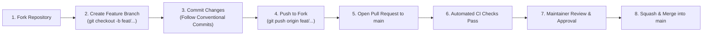

# 🤝 Contributing to BHUKKAD VERSE

Thank you for your interest in contributing to **BHUKKAD VERSE**! We welcome community contributions, bug fixes, feature proposals, and architectural enhancements.

To maintain code reliability, security, and production standards, **direct pushes to the `main` branch are strictly prohibited**. All contributions must be submitted via **Pull Requests (PR)** and pass automated validation checks before being reviewed and merged.

---

## 🔒 Code Governance & Pull Request Workflow



---

## 🛠️ Step-by-Step Contribution Guide

### 1. Fork & Clone
1. Fork the repository to your own GitHub account by clicking **Fork** in the top-right corner of [https://github.com/Ayush2809-tech/bhukkad-verse](https://github.com/Ayush2809-tech/bhukkad-verse).
2. Clone your fork locally:
   ```bash
   git clone https://github.com/<your-username>/bhukkad-verse.git
   cd bhukkad-verse
   ```

### 2. Create a Dedicated Feature Branch
Never make changes directly on `main`. Always create an isolated branch:
```bash
git checkout -b feat/your-feature-name
# or for bug fixes:
git checkout -b fix/issue-description
```

### 3. Local Development & Setup
Follow the standard quickstart from [README.md](README.md):
```bash
# Backend Setup
cd backend
python -m venv venv
# Activate venv, then:
pip install -r requirements.txt
python manage.py migrate
python seed_initial_data.py
python manage.py runserver

# Frontend Setup (in separate terminal)
cd frontend
npm install
npm run dev
```

### 4. Code Quality & Pre-Commit Checklist
Before submitting a PR, ensure your branch passes all checks:
- [ ] **Frontend TypeScript Check:** `cd frontend && npx tsc --noEmit` (Must have 0 errors)
- [ ] **Frontend Lint Check:** `cd frontend && npm run lint`
- [ ] **Backend Django Check:** `cd backend && python manage.py check`
- [ ] **Documentation Integrity:** Update `README.md` or `PROJECT_REPORT.md` if introducing new API endpoints or environment variables.

### 5. Submitting Your Pull Request
1. Push your branch to your fork:
   ```bash
   git push origin feat/your-feature-name
   ```
2. Navigate to [https://github.com/Ayush2809-tech/bhukkad-verse/pulls](https://github.com/Ayush2809-tech/bhukkad-verse/pulls) and click **New Pull Request**.
3. Select your fork and branch as the `head repository`, and `main` as the `base repository`.
4. Fill out the provided **Pull Request Template** completely.
5. Link any related open GitHub Issues (e.g., `Closes #12`).

---

## 📋 Commit Message Convention

We follow [Conventional Commits](https://www.conventionalcommits.org/):
- `feat: add live rider GPS tracking via WebSockets`
- `fix: resolve video autoplay policy on mobile browsers`
- `docs: update API endpoints table in PROJECT_REPORT`
- `perf: optimize continuous dish marquee animation frame rate`
- `refactor: extract cart calculation logic into standalone utility`

---

## 🛡️ Security Vulnerability Reporting

If you discover a security vulnerability within BHUKKAD VERSE, please **DO NOT** open a public issue. Instead, report it privately to the maintainer:
- **Lead Maintainer:** Ayush Saxena
- **Email:** `saxenaayush2809@gmail.com` / `support@bhukkadverse.com`

We will investigate and patch critical vulnerabilities before public disclosure.

---

## ⭐ Star the Project!
If you find BHUKKAD VERSE inspiring or useful for your own work, please consider giving the repository a **Star (⭐)** on GitHub! It helps other developers and creators discover the ecosystem.
