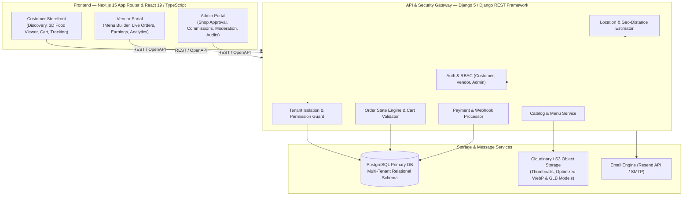
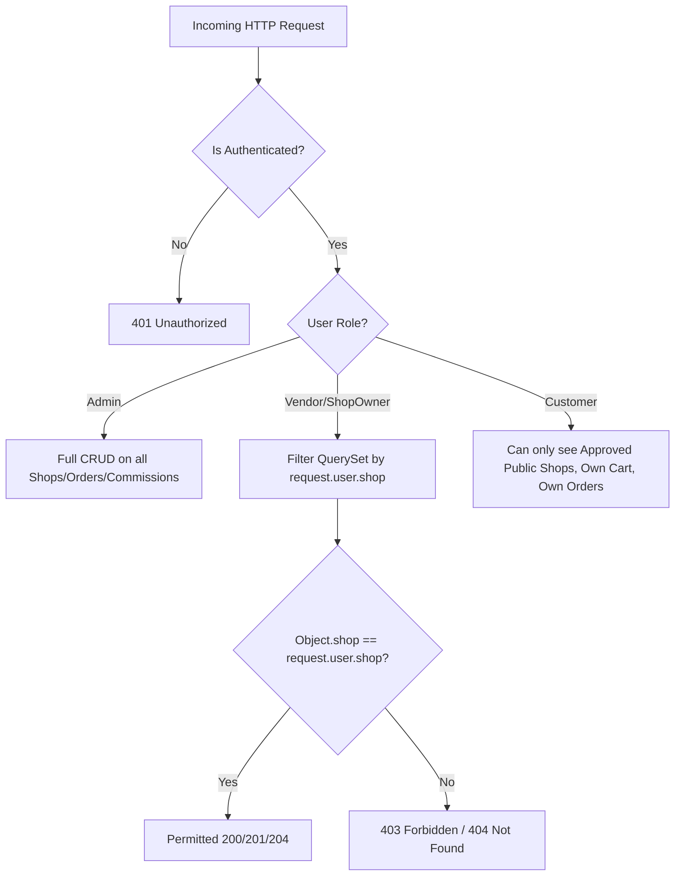
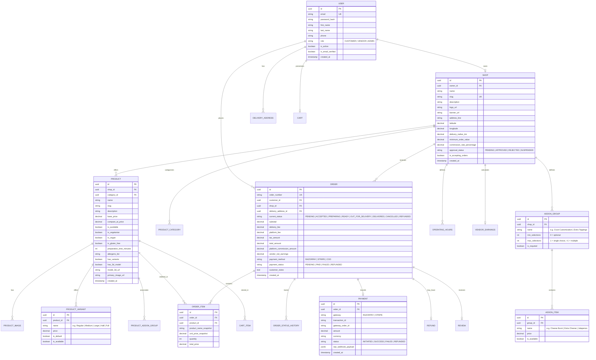
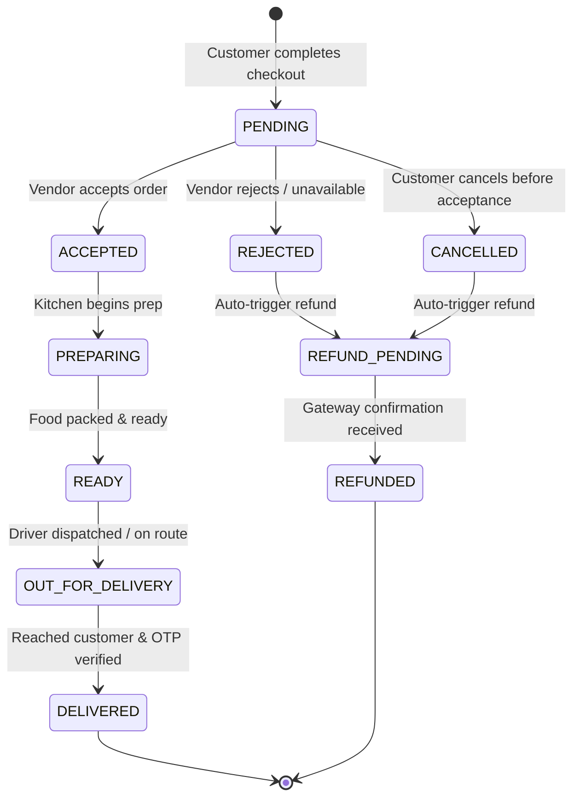

# BHUKKAD VERSE — Architecture Blueprint & Technical Specification
## Premium 3D Multi-Vendor Food Ordering & Local Delivery Platform
### "YOUR CRAVINGS. YOUR UNIVERSE."

---

### Executive Summary

**BHUKKAD VERSE** is an enterprise-grade, multi-vendor food marketplace combining an immersive, appetizing customer visual experience with a secure, isolated, scalable backend. 

Key pillars:
1. **Appetizing, Modern Indian Visual Design**: Warm cream background (`#FDFBF7`), deep rich charcoal (`#1A1A1A`), fiery tomato & vibrant orange accents (`#E63946`, `#FF5722`), golden amber (`#FFB703`), and 3D chef mascot branding.
2. **Selective & Optimized 3D Food Experiences**: React Three Fiber + Three.js for hero showcases and selected signature dishes, with instant fallback to optimized WebP images on low-power devices and mobile. Checkout and ordering flows remain strictly fast, lightweight, and independent of 3D rendering.
3. **Strict Multi-Vendor Isolation & Dynamic Menus**: Unified PostgreSQL database with enforced row-level and object-level authorization in Django REST Framework. Each vendor manages their own categories, products, configurable size variants (e.g. Regular/Medium/Large), and add-on groups (e.g. Extra Cheese, Cheese Burst, Toppings). No vendor can read or manipulate another vendor’s orders, menus, or earnings.
4. **End-to-End E-Commerce Flow**: Dynamic cart, server-validated pricing, strict order state machine, payment gateway integration (Razorpay / Stripe ready with mock sandbox test mode), delivery estimation (distance & route calculation), transactional emails (Resend / console fallback), and technical SEO.

---

## 1. System Architecture Diagram



---

## 2. Technical Stack & Documentation References

| Layer | Selected Technology | Purpose & Architectural Justification | Official Documentation / References |
| :--- | :--- | :--- | :--- |
| **Frontend** | Next.js 15 (App Router), React 19, TypeScript | Server-Side Rendering (SSR) for public shop & food SEO; static metadata generation; client components for interactive 3D and live dashboards. | [Next.js Documentation](https://nextjs.org/docs) <br/> [TypeScript Handbook](https://www.typescriptlang.org/docs/) |
| **Styling & UI** | Tailwind CSS v3/v4, Lucide Icons | Utility-first responsive design, consistent design tokens, dark/light contrast, mobile-first touch optimization. | [Tailwind CSS Docs](https://tailwindcss.com/docs) |
| **Animation** | Framer Motion / Motion | Micro-interactions, staggered catalog reveals, drawer transitions, cart bounce confirmations without blocking main thread. | [Motion Documentation](https://motion.dev/) |
| **3D Engine** | Three.js, React Three Fiber (R3F), `@react-three/drei` | Interactive 3D food presentations (orbit controls, contact shadows, studio environment lighting) for hero dishes. | [Three.js Docs](https://threejs.org/docs/) <br/> [R3F Documentation](https://docs.pmnd.rs/react-three-fiber/) |
| **Backend** | Python 3.10+, Django 5.x, Django REST Framework | Mature modular monolith, robust ORM, transactional integrity, built-in migration system, rate limiting, and RBAC. | [Django Docs](https://docs.djangoproject.com/) <br/> [DRF Guide](https://www.django-rest-framework.org/) |
| **Database** | PostgreSQL (with SQLite compatibility for lightweight local testing) | ACID compliance, relational integrity, foreign key cascading, JSONB attributes, geospatial coordinate math. | [PostgreSQL Documentation](https://www.postgresql.org/docs/) |
| **API Documentation** | drf-spectacular / OpenAPI 3.0 + Swagger / Redoc | Auto-generated, interactive API contracts for all client roles. | [drf-spectacular](https://drf-spectacular.readthedocs.io/) |
| **Payments** | Razorpay / Stripe Architecture with Webhook Verification | Tamper-proof server-side order generation, HMAC SHA-256 webhook signature validation, idempotency guards. | [Razorpay API Docs](https://razorpay.com/docs/api/) |
| **Email** | Resend API / Django SMTP backend | Clean transactional notifications for registration, order placed, status changes, and invoices. | [Resend Documentation](https://resend.com/docs) |
| **Maps & Geo** | Google Maps Platform / OpenStreetMap + Leaflet fallback | Geocoding, shop coordinates, Haversine/driving distance, ETA calculations. | [Google Maps Platform](https://developers.google.com/maps) |
| **Media Assets** | Cloudinary / S3 Storage Integration | Secure cloud uploads, automatic thumbnailing, responsive image variants, and 3D GLB model serving. | [Cloudinary Docs](https://cloudinary.com/documentation) |

### Design & Asset Inspiration
- **UI/UX & Branding**: Vadilal, Awwwards, Dribbble Food App UI, Behance Gourmet Case Studies, Swiggy & Zomato intuitive ordering flow.
- **3D Food Assets & Viewers**: Sketchfab (CC-BY licensed food assets), Poly Pizza (low-poly/optimized web models), Spline, CGTrader.

---

## 3. Practical 3D Strategy & Performance Safeguards

Following the user's practical recommendation:
1. **Selective 3D Usage**: 
   - **Hero Section**: 1 flagship 3D presentation (e.g. signature gourmet burger / artisanal bowl) with subtle auto-rotation, interactive orbit controls, lighting highlights, and hotspot breakdown.
   - **Signature Dish Badge**: Only products flagged with `has_3d_model: true` provide an interactive "View in 3D" modal/canvas.
   - **Catalog & Menus**: 95%+ of items use high-res, WebP-compressed photos with blur-up placeholders to guarantee instant 60 FPS scrolling.
2. **Performance Safeguards**:
   - Automatic WebGL capability detection.
   - Fallback to responsive 2D photography if WebGL is unsupported or GPU memory is low.
   - `IntersectionObserver`: 3D canvas is unmounted / paused when scrolled out of viewport.
   - `prefers-reduced-motion`: Disables auto-rotation and camera sweeps.
   - Zero 3D dependencies inside the Shopping Cart and Checkout pipelines to ensure zero latency during payment.

---

## 4. Multi-Vendor Data Isolation Architecture

To guarantee that shop owners can never access or modify each other's menus, orders, or private financial records:



### Security Enforcement Layers:
1. **Database Schema Isolation**:
   - `Shop` has a `OneToOneField` or `ForeignKey` to `User` (where `role='VENDOR'`).
   - `Product`, `Category`, and `Order` maintain foreign keys to `Shop`.
2. **Backend Queryset Scoping (`get_queryset`)**:
   - Vendor endpoints override `get_queryset()`:
     ```python
     def get_queryset(self):
         user = self.request.user
         if user.is_staff or user.role == 'ADMIN':
             return Order.objects.all()
         if user.role == 'VENDOR':
             return Order.objects.filter(shop__owner=user)
         return Order.objects.filter(customer=user)
     ```
3. **Object-Level Permissions**:
   - Custom DRF permission `IsShopOwnerOrAdmin` checks `obj.shop.owner == request.user` before `PUT`, `PATCH`, or `DELETE`.
4. **ID Enumeration Protection**:
   - UUIDs or slug-based obfuscation for public access; attempts to guess order numbers or product IDs across tenants result in immediate `404 Not Found` or `403 Forbidden`.

---

## 5. Comprehensive Database Entity-Relationship Model



---

## 6. Order State Machine



### State Transition Validation Rules:
- **Customer Cancellation**: Allowed only while in `PENDING` state.
- **Vendor Actions**: Vendor can transition `PENDING` -> `ACCEPTED`/`REJECTED`, `ACCEPTED` -> `PREPARING`, `PREPARING` -> `READY`, `READY` -> `OUT_FOR_DELIVERY`.
- **System Actions**: Transition to `DELIVERED` emits automated invoice emails and credit ledger entry for vendor net payout.

---

## 7. REST API Endpoints Specification

### Authentication & Account (`/api/v1/auth/`)
- `POST /register/` — Customer & Vendor registration with role selection.
- `POST /login/` — Issue JWT tokens (access + refresh) with secure HTTP-only cookies.
- `POST /token/refresh/` — Refresh access token.
- `POST /logout/` — Invalidate session and clear cookies.
- `GET/PUT /me/` — Retrieve/update user profile.
- `GET/POST /addresses/` — Manage delivery addresses with latitude/longitude coordinates.

### Public Discovery & Marketplace (`/api/v1/discovery/`)
- `GET /shops/` — Public list of approved shops (filterable by category, distance, rating, search query).
- `GET /shops/{slug}/` — Single shop details with active operating hours, rating, and menu categories.
- `GET /shops/{slug}/menu/` — Full menu with categories, items, prices, diet tags, and 3D availability.
- `GET /featured-dishes/` — Curated dishes with 3D models for homepage interactive presentation.
- `POST /delivery-estimate/` — Calculate delivery distance, delivery fee, and ETA given user coordinates.

### Cart & Checkout (`/api/v1/cart/` & `/api/v1/orders/`)
- `GET /cart/` — Retrieve user's active cart with recalculated prices from database.
- `POST /cart/items/` — Add item to cart (enforces single-vendor cart constraint with clear prompt to clear if switching shops).
- `PATCH /cart/items/{id}/` — Update quantity.
- `DELETE /cart/items/{id}/` — Remove item from cart.
- `POST /orders/checkout/` — Atomic transaction: validate stock, verify live prices, create `PENDING` order, initialize Razorpay payment order.
- `GET /orders/` — Customer order history.
- `GET /orders/{id}/` — Customer live order tracking and status history.
- `POST /orders/{id}/cancel/` — Customer cancel request.

### Vendor Management Portal (`/api/v1/vendor/`)
- `GET/PUT /shop/` — Manage own shop details, delivery radius, opening hours, banner image.
- `GET/POST /products/` — Vendor menu management (CRUD).
- `PATCH /products/{id}/toggle-availability/` — Quick in-stock/86 switch.
- `GET /orders/` — Vendor incoming live orders queue.
- `PATCH /orders/{id}/status/` — Update order state (`ACCEPTED`, `PREPARING`, `READY`, etc.).
- `GET /analytics/` — Sales breakdown, total orders, commission fee deductions, net payout balance.

### Platform Administration (`/api/v1/admin/`)
- `GET /shops/pending/` — List vendor shop applications awaiting review.
- `POST /shops/{id}/approve/` — Approve shop and activate public discovery.
- `POST /shops/{id}/reject/` — Reject shop with reason.
- `GET/PATCH /commissions/` — View and configure platform commission percentages.
- `GET /overview/` — Platform-wide GMV, net revenue, active vendors, order disputes.

### Payments & Webhooks (`/api/v1/payments/`)
- `POST /create-payment-intent/` — Generate server-validated gateway order id.
- `POST /verify/` — Validate payment signature from client submission.
- `POST /webhook/` — Raw HMAC webhook listener for asynchronous payment capture and refund events.

---

## 8. Directory Structure (Modular Monolith)

```
pp2/
├── backend/
│   ├── manage.py
│   ├── requirements.txt
│   ├── Dockerfile
│   ├── foodhub/                  # Django project root
│   │   ├── __init__.py
│   │   ├── settings.py           # Configured for PostgreSQL, JWT, CORS, Media
│   │   ├── urls.py               # Root URL configuration + OpenAPI Swagger
│   │   ├── wsgi.py
│   │   └── asgi.py
│   └── apps/                     # Modular domain apps
│       ├── authentication/       # User model, RBAC, JWT, Profiles
│       ├── shops/                # Shop, OperatingHours, Approval, Geo discovery
│       ├── products/             # Product, Category, 3D Asset metadata
│       ├── orders/               # Cart, Order, OrderItem, State Machine
│       ├── payments/             # Razorpay/Stripe, Webhooks, Commission Ledger
│       ├── notifications/        # Resend email templates & async dispatch
│       └── analytics/            # Vendor & Admin reporting
├── frontend/
│   ├── package.json
│   ├── tsconfig.json
│   ├── tailwind.config.ts
│   ├── next.config.ts
│   ├── Dockerfile
│   ├── public/
│   │   ├── models/               # Optimized GLB 3D food models
│   │   ├── images/               # High-res curated food photography
│   │   └── icons/
│   └── src/
│       ├── app/                  # Next.js 15 App Router
│       │   ├── layout.tsx        # Global shell, fonts, providers, toast
│       │   ├── page.tsx          # Premium Homepage with 3D Hero Showcase
│       │   ├── (auth)/           # Login, Register, Vendor onboarding
│       │   ├── shops/            # Public shop browsing & detail pages
│       │   ├── dishes/           # Public food catalogue & 3D dish modal
│       │   ├── cart/             # Cart review & delivery calculation
│       │   ├── checkout/         # Secure checkout & payment modal
│       │   ├── orders/           # Customer tracking & order history
│       │   ├── vendor/           # Vendor isolated portal (dashboard, orders, menu)
│       │   ├── admin/            # Superadmin dashboard (approvals, commission)
│       │   ├── robots.ts         # Technical SEO robots.txt
│       │   └── sitemap.ts        # Dynamic XML sitemap
│       ├── components/
│       │   ├── ui/               # Buttons, Inputs, Cards, Badges, Modals
│       │   ├── 3d/               # FoodViewer3D, CanvasContainer, Lighting, Fallback
│       │   ├── home/             # Hero, CategoryGrid, NearbyShops, DishShowcase
│       │   ├── layout/           # Navbar, LocationSelector, Footer
│       │   └── orders/           # LiveTrackingStatus, OrderStepper
│       ├── context/              # AuthContext, CartContext, LocationContext
│       ├── lib/                  # API client, formatters, geo calculations
│       └── types/                # Strict TypeScript interfaces
└── docker-compose.yml            # Multi-container orchestration (DB, API, Web, Redis)
```

---

## 9. Implementation Roadmap & Phases

- **Phase 1 (Current)**: Inspection, Architecture Design, Schema & API Contract Finalization *(In progress)*.
- **Phase 2 (Foundation)**: 
  - Django project scaffolding with modular apps.
  - Next.js 15 App Router setup with Tailwind CSS and TypeScript.
  - PostgreSQL database configuration with migrations.
  - Verification of dev servers and API connectivity.
- **Phase 3 (Core Application & Multi-Tenant Backend)**:
  - Custom User model with Role-Based Access Control.
  - Shop registration & Admin approval workflow.
  - Product catalog CRUD with vendor tenant isolation.
  - Cart engine with server-side validation & order state machine.
- **Phase 4 (Premium Frontend & 3D Showcase)**:
  - Awwwards-inspired modern UI design with curated palette & typography.
  - Interactive 3D Food Showcase in Hero section using R3F.
  - Shop discovery with location selector, filter pills, and search.
  - High-performance product cards with 3D toggle where available.
- **Phase 5 (Integrations)**:
  - Razorpay payment simulation & webhook handler.
  - Resend email notification service (with dev console fallback).
  - Geocoding and distance estimation for delivery fee & ETA calculation.
- **Phase 6 (Quality, Security & Testing)**:
  - Automated tests for tenant isolation (cross-tenant access denial).
  - Order state machine transition verification.
  - Cart integrity tests (preventing price tampering).
  - Responsive layout validation across mobile, tablet, and desktop.
- **Phase 7 (Deployment Readiness & Documentation)**:
  - Production Docker Compose setup.
  - Environment variables documentation (`.env.example`).
  - Production readiness guide & backup runbook.
