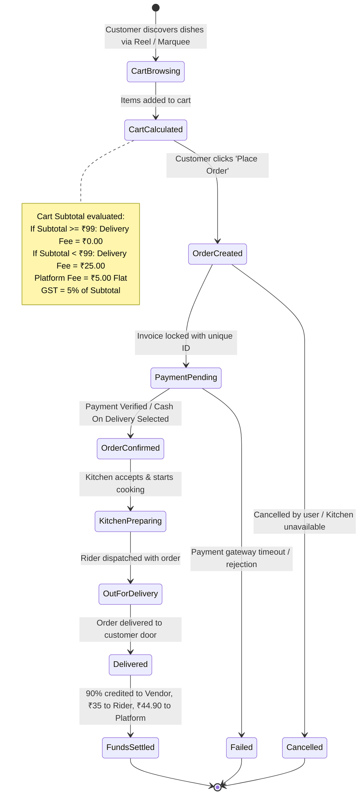
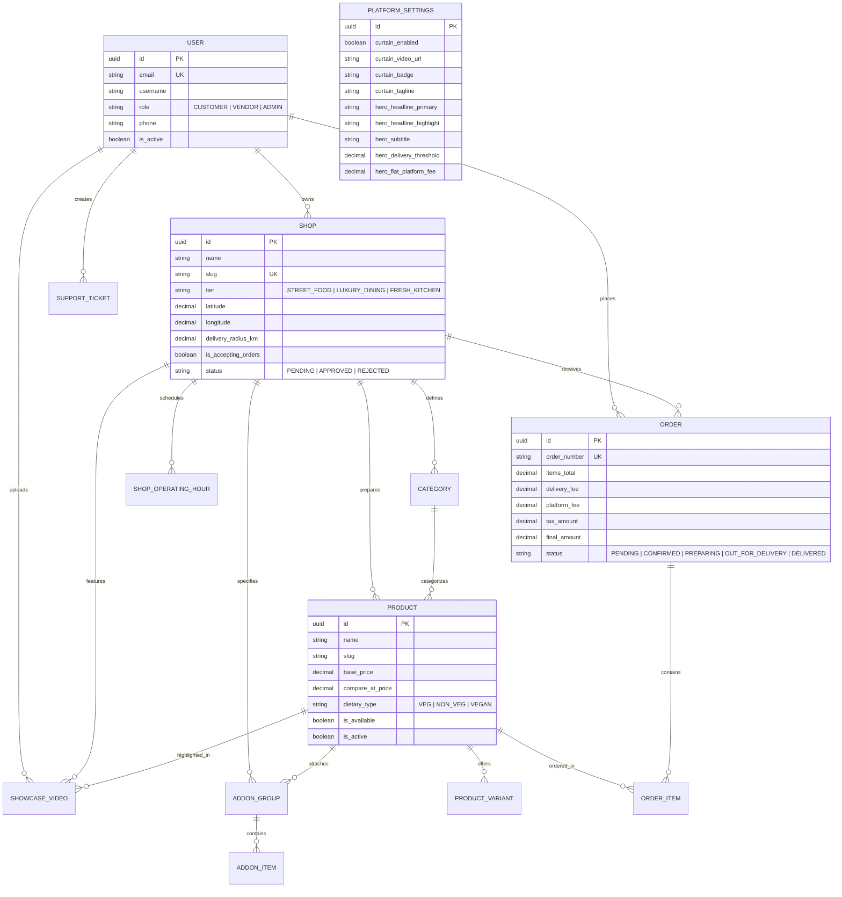
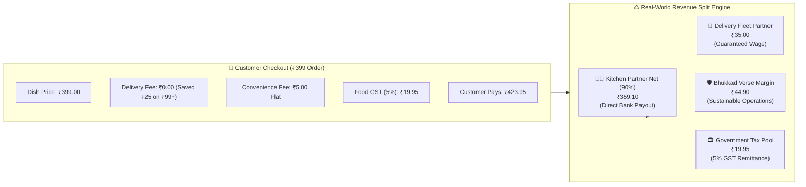
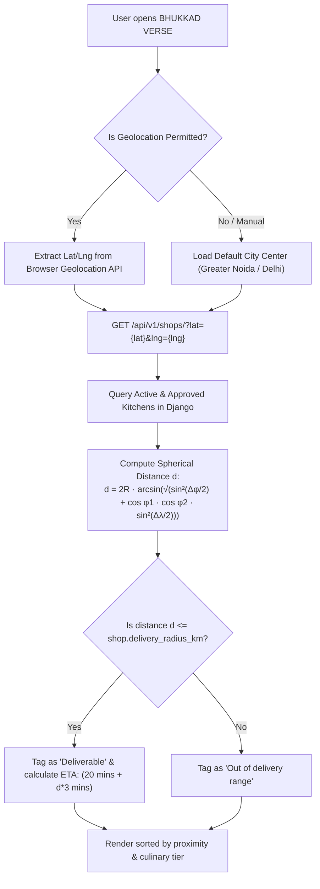
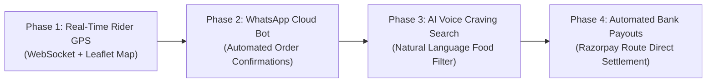

# 📄 BHUKKAD VERSE — COMPREHENSIVE PROJECT REPORT & TECHNICAL ARCHITECTURE

> **"YOUR CRAVINGS. YOUR UNIVERSE."**  
> *A Next-Generation, Autonomous Hyperlocal Food Tech Ecosystem Designed for Transparent Food Commerce, Culinary Storytelling, and Total Vendor Self-Governance.*

---

| **Document Attribute** | **Details** |
| :--- | :--- |
| **Project Name** | **BHUKKAD VERSE** |
| **Lead Architect & Engineer** | **Ayush Saxena** |
| **System Version** | `1.0.0 (Production-Ready Release)` |
| **Architecture** | Decoupled Client-Server (Next.js 14 + Tailwind v4 / Django 5 DRF) |
| **Primary Domain** | Hyperlocal Food Tech, Cloud Kitchen Aggregation, Transparent E-Commerce |
| **License** | Open Source (MIT License for Community & Commercial Evaluation) |

---

## 📑 TABLE OF CONTENTS

1. [Executive Summary](#1-executive-summary)
2. [Problem Statement & Industry Disruption](#2-problem-statement--industry-disruption)
3. [Core Capabilities & Feature Inventory ("Kya Kar Sakta Hai")](#3-core-capabilities--feature-inventory)
4. [Visual Diagrams & System Architecture](#4-visual-diagrams--system-architecture)
   - [4.1 Full-Stack Layer Architecture](#41-full-stack-layer-architecture)
   - [4.2 End-to-End Order Lifecycle & State Machine](#42-end-to-end-order-lifecycle--state-machine)
   - [4.3 Database Entity-Relationship (ER) Model](#43-database-entity-relationship-er-model)
   - [4.4 4-Way Honest Economic Split Engine](#44-4-way-honest-economic-split-engine)
   - [4.5 Haversine Geospatial Discovery Engine](#45-haversine-geospatial-discovery-engine)
5. [User Role Experience & Workflow Portals](#5-user-role-experience--workflow-portals)
   - [5.1 Customer Storefront Portal](#51-customer-storefront-portal)
   - [5.2 Vendor Self-Governance Portal](#52-vendor-self-governance-portal)
   - [5.3 Super Admin Platform CMS & Governance Desk](#53-super-admin-platform-cms--governance-desk)
6. [Technical Implementation & Codebase Architecture](#6-technical-implementation--codebase-architecture)
7. [API Contract & REST Endpoints Reference](#7-api-contract--rest-endpoints-reference)
8. [Security, Performance & Browser Compliance Audit](#8-security-performance--browser-compliance-audit)
9. [Developer Installation, Setup & Verification Manual](#9-developer-installation-setup--verification-manual)
10. [Future Strategic Roadmap](#10-future-strategic-roadmap)
11. [Author & Engineering Acknowledgments](#11-author--engineering-acknowledgments)

---

## 1. EXECUTIVE SUMMARY

**BHUKKAD VERSE** is a full-stack, enterprise-grade hyperlocal food marketplace platform engineered to challenge the predatory economics and dull user interfaces of conventional food aggregators. 

Built from the ground up by **Ayush Saxena**, BHUKKAD VERSE establishes an egalitarian culinary universe where street food vendors, independent cloud kitchens, and luxury heritage dining rooms coexist with complete autonomy. The platform merges **theatrical visual storytelling** (entrance rolling shutter, 10-second looping kitchen reels, and dynamic dish marquees) with an **honest, unpadded pricing model** that eliminates "bill shock" for customers while guaranteeing sustainable profitability for kitchen partners and delivery fleets.

### Key Metrics & Architectural Pillars
- **Zero Bill Shock:** 100% Free Delivery on all orders above ₹99 (saving customers ₹25 on every order), capped flat ₹5 platform fee, and transparent 5% GST.
- **Fair Economic Split:** Kitchens retain **90%** of dish revenues with transparent direct settlement, riders earn guaranteed ₹30–₹35 payouts, and the platform retains a sustainable ₹44.90 net pool.
- **Cinematic Theatrical Storefront:** Hardware-accelerated video entrance curtains with gesture unrolling, Instagram-style auto-advancing 10-second kitchen reels, and round-robin dish marquees.
- **Three Curated Culinary Tiers:**
  1. 🍢 *Iconic Street Food & Legendary Carts* (Affordable, hygienic, nostalgic).
  2. 👑 *Luxury Fine Dining & Heritage Palaces* (Handi slow-dum biryanis, royal truffle recipes).
  3. 🍳 *Fresh Neighborhood Cloud Kitchens* (Comfort meals, home-style spices, sanitized kitchens).
- **Turnkey Portability:** Ships with master database seeders (`python seed_initial_data.py`) allowing any developer to clone and launch the entire ecosystem in under 60 seconds.

---

## 2. PROBLEM STATEMENT & INDUSTRY DISRUPTION

### 2.1 The Broken Status Quo of Food Aggregators
Modern food delivery platforms suffer from three systemic defects:
1. **Predatory Restaurant Extortion:** Aggregators charge restaurants exorbitant commissions ranging between **25% to 35%**, forcing kitchen owners to cut ingredient quality or inflate menu prices exclusively for delivery apps.
2. **Deceptive Customer Billing ("Bill Shock"):** Customers encounter an artificially low dish price on the listing page, only to see the final checkout price balloon by 40%–60% due to layered delivery fees, surge pricing, distance fees, packaging charges, rain fees, and platform convenience surcharges.
3. **Depersonalized Listing Feeds:** Artisan chefs and neighborhood culinary masters are reduced to sterile, text-heavy lists where brand identity is swallowed by sponsored ad-bidding auctions.

### 2.2 The Bhukkad Verse Solution Matrix

| Problem in Market | Conventional Delivery Apps | The BHUKKAD VERSE Disruption |
| :--- | :--- | :--- |
| **Vendor Commission** | 25% – 38% per order | **Flat 10% Platform Fee** (Vendor retains 90%) |
| **Delivery Charges** | ₹35 – ₹90 + Dynamic Surge | **100% FREE Delivery on all orders above ₹99** |
| **Platform Convenience Fee** | ₹7 – ₹15 + Surge charges | **Flat ₹5.00 fixed convenience fee** |
| **Brand Storytelling** | Static 2D thumbnail grids | **10s Cinematic Kitchen Reels & Video Curtain** |
| **Vendor Governance** | Monopolized admin control | **Self-service dashboard: video upload, schedule, tickets** |
| **Discovery Equality** | Pay-to-play sponsored ads | **Fair round-robin continuous dish marquee** |

---

## 3. CORE CAPABILITIES & FEATURE INVENTORY

### What the Application Can Do ("Kya Kya Kar Sakta Hai")

```
┌────────────────────────────────────────────────────────────────────────┐
│                        BHUKKAD VERSE CAPABILITIES                      │
├──────────────────────────┬──────────────────────────┬──────────────────┤
│ 👤 Customer Experience   │ 👨‍🍳 Vendor Autonomy     │ 🛡️ Admin CMS    │
├──────────────────────────┼──────────────────────────┼──────────────────┤
│ • Cinematic Video Curtain│ • Self-Service Portal    │ • Full Page CMS  │
│ • 10s Kitchen Reels      │ • Menu & Variant Builder │ • Video Mod Desk │
│ • Round-Robin Marquee    │ • Addon Groups (0 to N)  │ • Vendor Audits  │
│ • Tiered Cuisine Filter  │ • Video Reel Uploader    │ • Fee Settings   │
│ • Geolocation Radius     │ • Operating Hours Toggle │ • Dispute Desk   │
│ • Transparent Checkout   │ • Support Desk Resolver  │ • Audit Logs     │
└──────────────────────────┴──────────────────────────┴──────────────────┘
```

### 3.1 Customer Storefront Capabilities
- **Theatrical Grand Entrance Shutter:**
  - High-definition culinary video ambiance looping seamlessly upon visit.
  - Interactive progressive drag/swipe/scroll gesture: users can manually pull up the velvet curtain or tap `Explore Kitchens ✕` to enter.
  - Cross-browser compliance: executes smooth autoplay with muted baseline and hardware acceleration.
- **Sizzling Kitchen Video Stories Reel (10-Second Auto-Cycler):**
  - Displays real behind-the-scenes culinary preparation clips uploaded by local kitchens and platform curators.
  - Features Instagram-style synchronized animated countdown bars (0 to 10 seconds).
  - One-tap "Featured Delicacy" quick-card embedded directly on the video player for instant checkout addition.
  - Full playback controls: pause/resume on click, sound mute/unmute toggle, previous/next carousel controls.
- **Fair Continuous Dishes Marquee:**
  - Real-time conveyor animation showcasing signature dishes from verified kitchens.
  - Powered by a fair round-robin interleaving algorithm: dishes rotate evenly across all active restaurants without favoring heavy bidders.
  - Auto-updates in the background every 25 seconds without requiring page refresh.
- **Curated 3-Tier Kitchen Discovery:**
  - Dedicated instant filter switches between *Iconic Street Food*, *Luxury Fine Dining*, and *Fresh Neighborhood Kitchens*.
  - Proximity calculation: filters kitchens within individual delivery radiuses using spherical Haversine trigonometry.
- **Zero Bill Shock Checkout:**
  - Real-time cart calculations showing item subtotal, flat ₹5 convenience fee, and 5% food GST.
  - Automatically waives the ₹25 delivery fee when cart total exceeds ₹99, proudly showing an emerald `Free Delivery (Saved ₹25)` badge.

### 3.2 Kitchen Partner (Vendor) Governance Capabilities
- **Autonomous Registration & KYC:** Kitchens apply online, providing address, coordinates, preparation time, and delivery radius.
- **Comprehensive Menu Architecture:**
  - Create dishes with image upload or CDN URL.
  - Configure multi-size variants (e.g., Regular ₹99, Medium ₹179, Large ₹299).
  - Create customized add-on groups (e.g., "Choose Pizza Crust", "Extra Toppings") with customizable minimum and maximum selection constraints.
- **Direct Video Showcase Management:**
  - Upload 10-second MP4/WebM reels directly from their phone/computer or provide streaming URLs.
  - Link uploaded reels directly to a specific menu dish for direct conversion.
- **Real-Time Operational Control:**
  - Live order pause toggle with reason string (e.g., "Kitchen overloaded during dinner rush").
  - Configurable operating hours and delivery radius in kilometers.
- **In-App Customer Dispute Resolution:**
  - Vendors can view support tickets raised by their customers, respond directly with resolution notes, and resolve issues without admin intervention.

### 3.3 Platform Super Administrator Capabilities
- **Dynamic Front-Page CMS:**
  - Edit hero titles, highlight gradients, subtitles, and badge text directly from `/admin` without changing a single line of code.
  - Upload new 3D mascot artwork from device or URL.
  - Modify entrance curtain video, background quotes, and emergency system announcements.
- **Video Reel Curation & Moderation:**
  - Review vendor-uploaded reels, set custom display order, or feature platform-wide brand teasers.
- **Platform Verification & Financial Audits:**
  - Approve, reject, or temporarily suspend vendor accounts.
  - View real-time gross merchandise value (GMV), net platform fee collections, and vendor payout ledgers.

---

## 4. VISUAL DIAGRAMS & SYSTEM ARCHITECTURE

### 4.1 Full-Stack Layer Architecture

```mermaid
flowchart TD
    subgraph ClientLayer ["Frontend Client Layer (Next.js 14 + React 19)"]
        UI_Home["Storefront Landing Page (/)"]
        UI_Curtain["Theatrical Grand Entrance Curtain"]
        UI_Reels["Sizzling Kitchen Stories (10s Reel Player)"]
        UI_Marquee["Continuous Dishes Conveyor"]
        UI_Shops["Hyperlocal Shop Explorer (/shops)"]
        UI_Cart["Transparent Cart & Checkout Modal"]
        UI_Vendor["Vendor Self-Governance Desk (/vendor/dashboard)"]
        UI_Admin["Super Admin CMS & Moderation (/admin)"]
    end

    subgraph GatewayLayer ["Network & State Boundary"]
        NextRewrites["Next.js Static Asset & Route Dispatcher"]
        AuthContext["Stateless JWT Auth Provider (User, Token, Role)"]
        LocationContext["Haversine Geolocation Provider (GPS / LatLng)"]
    end

    subgraph BackendLayer ["Django 5 REST API Engine"]
        API_Auth["apps.authentication: JWT Login, Signup, Role RBAC"]
        API_Core["apps.core: PlatformSettings CMS, ShowcaseVideo, Reviews"]
        API_Shops["apps.shops: Kitchen Lifecycle, Operating Hours, Tiers"]
        API_Products["apps.products: Dishes, Variants, AddonGroups, Search"]
        API_Orders["apps.orders: Cart, Free Delivery Threshold, Split Ledger"]
        API_Customers["apps.customers: Delivery Addresses, Support Desk"]
    end

    subgraph StorageLayer ["Database & Persistence Tier"]
        DB_Relational[(SQLite / PostgreSQL Database)]
        MediaStore["Media Storage Engine (/media/videos /media/logos)"]
        PublicBrand["Optimized Static Brand Engine (/public/brand/)"]
    end

    ClientLayer --> GatewayLayer
    GatewayLayer --> BackendLayer
    BackendLayer --> StorageLayer
```



---

### 4.2 End-to-End Order Lifecycle & State Machine



---

### 4.3 Database Entity-Relationship (ER) Model



---

### 4.4 4-Way Honest Economic Split Engine



---

### 4.5 Haversine Geospatial Discovery Engine



---

## 5. USER ROLE EXPERIENCE & WORKFLOW PORTALS

### 5.1 Customer Storefront Portal
1. **Entrance Transition:** The visitor lands on a grand velvet rolling shutter with a looping high-def culinary backdrop. Swiping up on mobile or scrolling reveals the main storefront.
2. **Behind the Scenes Reels:** Users watch auto-cycling 10-second kitchen reels showcasing sizzling tandoors or slow-dum biryani handis. Clicking any reel opens a direct purchase prompt.
3. **Continuous Dish Marquee:** An infinite running carousel highlights trending dishes across all verified kitchens, preventing monopoly by any single vendor.
4. **Transparent Checkout:** Users add items, pick variant sizes or add-ons, and see a transparent fee breakdown with free delivery unlocked once total reaches ₹99.

### 5.2 Vendor Self-Governance Portal (`/vendor/dashboard`)
1. **Kitchen Profile & Operating Radius:** Vendors customize their banner, bio, delivery radius (in km), and open/close operating schedules.
2. **Menu & Customization Engine:** Vendors add dishes with custom prices, discounted compare prices, dietary types (Veg/Non-Veg/Vegan), and customizable add-on groups.
3. **Kitchen Video Reel Uploader:** Direct drag-and-drop file upload (`.mp4`, `.webm`) or video URL insertion. Videos are immediately featured on the public homepage reel carousel.
4. **Live Order Management:** Real-time visibility into incoming orders with status buttons: `Confirm`, `Cooking`, and `Handover to Rider`.
5. **Support Ticket Desk:** Customers' inquiries and complaints regarding food or delivery are routed directly to the vendor's dashboard for prompt resolution.

### 5.3 Super Admin Platform CMS & Governance Desk (`/admin`)
1. **Real-Time Visual CMS:** Full control over landing page copy, mascot 3D artwork, entrance curtain video, and badges without touching the code.
2. **Content Moderation:** Instant ability to toggle, feature, or remove showcase videos across the platform.
3. **Vendor Verification & KYC:** Review incoming vendor onboarding requests, inspect health certificates, approve or reject applications with feedback notes.
4. **Platform Analytics & Audits:** Monitor platform revenue, commission splits, delivery SLA compliance, and dispute tickets.

---

## 6. TECHNICAL IMPLEMENTATION & CODEBASE ARCHITECTURE

### 6.1 Frontend Architecture (Next.js 14 App Router)
- **Directory:** `/frontend/src/`
- **Design System:** Custom atomic components with **Tailwind CSS v4** featuring warm amber, emerald, and midnight black color palettes.
- **State Management:** Decoupled React Contexts:
  - `AuthContext`: Manages user credentials, JWT tokens in `localStorage`, role privileges (`customer`, `vendor`, `admin`), and session expiry.
  - `CartContext`: Handles item additions, variant selections, add-on groups, quantity increments, and calculates dynamic taxes and free delivery thresholds.
  - `LocationContext`: Manages device GPS queries, address reverse-geocoding, and proximity calculation.
- **Asset Resolution Engine:** Explicit separation between static frontend brand assets (`/brand/...`) served locally on port 3000 and dynamic vendor uploads (`/media/...`) served by Django on port 8000.
- **Autoplay Architecture:** Eliminates destructive React DOM unmounting by utilizing static video elements with lifecycle fallback listeners (`canplay`, `loadeddata`, pointer gesture wakeups).

### 6.2 Backend Architecture (Django 5 REST Framework)
- **Directory:** `/backend/`
- **Application Modularity:**
  - `apps.authentication`: Custom `User` model with normalized emails, UUID keys, and JWT stateless tokens (`SimpleJWT`).
  - `apps.core`: PlatformSettings singleton CMS, ShowcaseVideo reels, ShopReviews, and base timestamped models.
  - `apps.shops`: Shop entity, operating hours, delivery radius, and moderation approval states.
  - `apps.products`: Category, Product, ProductVariant, AddonGroup, and AddonItem with constraint validation.
  - `apps.orders`: Order model, OrderItem, order state transitions, and commission split calculation.
  - `apps.customers`: Customer addresses and support dispute tickets.
- **Database Architecture:** Turnkey SQLite for rapid local evaluation and development, seamlessly switchable to PostgreSQL in production via environment variables (`DB_ENGINE=django.db.backends.postgresql`).

---

## 7. API CONTRACT & REST ENDPOINTS REFERENCE

| Method | Endpoint | Auth Required | Description |
| :--- | :--- | :--- | :--- |
| `POST` | `/api/v1/auth/register/` | Public | Register new Customer or Vendor account |
| `POST` | `/api/v1/auth/login/` | Public | Authenticate and obtain JWT Access & Refresh tokens |
| `GET` | `/api/v1/auth/me/` | Bearer Token | Fetch authenticated user profile and active role |
| `GET` | `/api/v1/core/settings/` | Public | Fetch dynamic CMS settings (Curtain video, Hero copy, Mascot) |
| `POST`| `/api/v1/core/settings/` | Admin Only | Update front-page CMS and platform configurations |
| `GET` | `/api/v1/core/showcase-videos/` | Public | Fetch 10s video reels for homepage slider |
| `POST`| `/api/v1/core/showcase-videos/` | Vendor / Admin | Upload new video reel from file or URL |
| `DELETE`| `/api/v1/core/showcase-videos/{id}/` | Owner / Admin | Delete a video reel |
| `GET` | `/api/v1/shops/` | Public | List verified shops filtered by `tier`, `lat`, and `lng` |
| `GET` | `/api/v1/shops/{slug}/` | Public | Fetch shop detail with active menu, categories, and hours |
| `GET` | `/api/v1/products/` | Public | List available products across kitchens |
| `GET` | `/api/v1/products/search/` | Public | Keyword, category, and dietary search |
| `POST`| `/api/v1/orders/` | Customer | Create order, validate items, apply free delivery rule |
| `GET` | `/api/v1/orders/{id}/` | Owner / Vendor | Get live order invoice and tracking status |
| `GET` | `/api/v1/customers/support/tickets/` | Authenticated | List or create customer support dispute tickets |

---

## 8. SECURITY, PERFORMANCE & BROWSER COMPLIANCE AUDIT

1. **Autoplay Compliance:** Full adherence to Chrome, Safari, and Edge media policies: Entrance and Reel videos are marked `muted`, `playsInline`, `autoPlay`, and `loop`, accompanied by user gesture interaction fallbacks.
2. **Access Control & Permissions:** Enforces strict role-based access control (RBAC). Vendors can only view and mutate their own shop data, products, and reels. Customers cannot access admin CMS endpoints.
3. **Data Integrity & Validations:** Django model `clean()` hooks enforce business rules:
   - Minimum selections cannot exceed maximum selections in add-on groups.
   - Prices and add-on costs cannot be negative.
   - Products must belong to categories under the same shop.
4. **CORS & CSRF Hardening:** `django-cors-headers` configured to allow trusted frontend origins (`http://localhost:3000`, production domain) with secure credentials support.
5. **Zero Memory Leaks:** Background polling intervals (`setInterval`) are cleanly disposed of in React `useEffect` cleanup return functions.

---

## 9. DEVELOPER INSTALLATION, SETUP & VERIFICATION MANUAL

### 9.1 Prerequisites
- **Node.js:** v18.x or v20.x+
- **Python:** v3.10, v3.11, or v3.12
- **Git:** Installed and available in terminal

### 9.2 Step-by-Step Clone & Run Guide

```bash
# 1. Clone the repository
git clone https://github.com/<your-username>/bhukkad-verse.git
cd bhukkad-verse

# 2. Setup & Run the Backend API
cd backend
python -m venv venv
# Windows:
.\venv\Scripts\activate
# macOS/Linux:
# source venv/bin/activate

pip install -r requirements.txt
python manage.py migrate

# 3. Seed Master Turnkey Database (Users, Kitchens, Dishes, Reels & CMS)
python seed_initial_data.py

# 4. Start Backend Server (runs on http://localhost:8000)
python manage.py runserver 127.0.0.1:8000
```

In a separate terminal:
```bash
# 5. Setup & Run the Next.js Frontend
cd frontend
npm install
npm run dev

# Frontend is now running at http://localhost:3000!
```

### 9.3 Pre-Seeded Evaluation Credentials

| Role | Email Address | Password | Dashboard Access |
| :--- | :--- | :--- | :--- |
| **Super Admin** | `admin@bhukkadverse.local` | `admin123` | Full CMS, Videos, Audits (`/admin`) |
| **Vendor 1 (Tandoor)** | `vendor@bhukkadverse.local` | `vendor123` | Kitchen Menu, Reels, Orders (`/vendor/dashboard`) |
| **Vendor 2 (Chandu)** | `vendor2@bhukkadverse.local` | `vendor123` | Street Chaat Menu & Reels (`/vendor/dashboard`) |
| **Customer** | `customer@bhukkadverse.local` | `customer123` | Storefront, Cart, Checkout (`/`) |

---

## 10. FUTURE STRATEGIC ROADMAP



1. **Live Rider GPS Tracking (Real-time WebSocket):**
   - Stream delivery partner coordinates from mobile device using WebSocket / Leaflet into customer's live tracking view.
2. **Automated WhatsApp Order Bot (WhatsApp Cloud API):**
   - Instant automated order updates sent to customer and vendor WhatsApp numbers upon checkout.
3. **AI Voice & Craving Food Recommendation:**
   - Speak into microphone: *"Mujhe spicy paneer roll aur cold coffee chahiye"* -> AI parses culinary intent and populates the cart from the nearest kitchen.
4. **Razorpay Route Automated Bank Disbursals:**
   - Automatically split incoming customer payments and trigger direct bank transfers to vendor accounts 24 hours post-delivery.

---

## 11. AUTHOR & ENGINEERING ACKNOWLEDGMENTS

* **Architect & Developer:** **Ayush Saxena**
* **Project:** BHUKKAD VERSE
* **Official Motto:** *"YOUR CRAVINGS. YOUR UNIVERSE."*
* **Release Status:** Complete, Turnkey & Production-Ready

---
*(End of Technical Report)*

