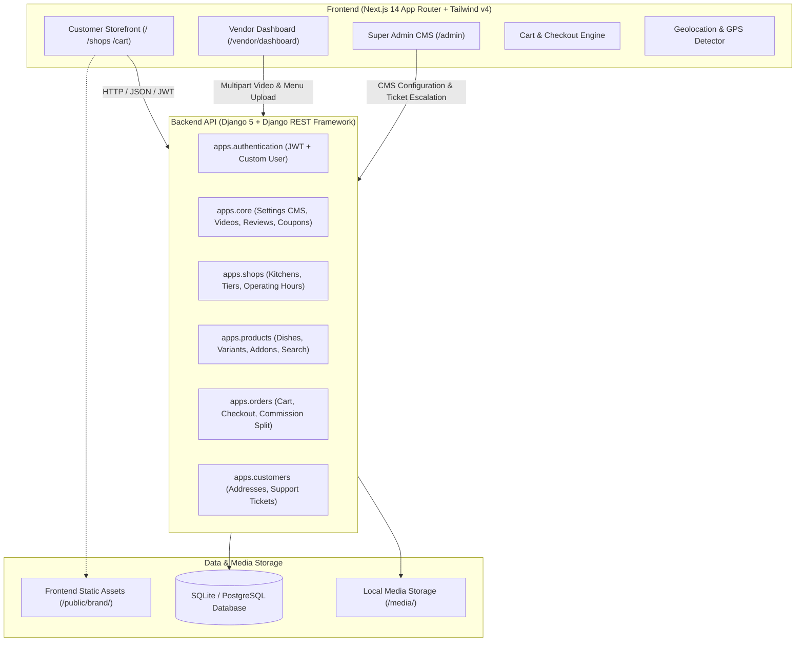
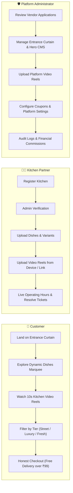
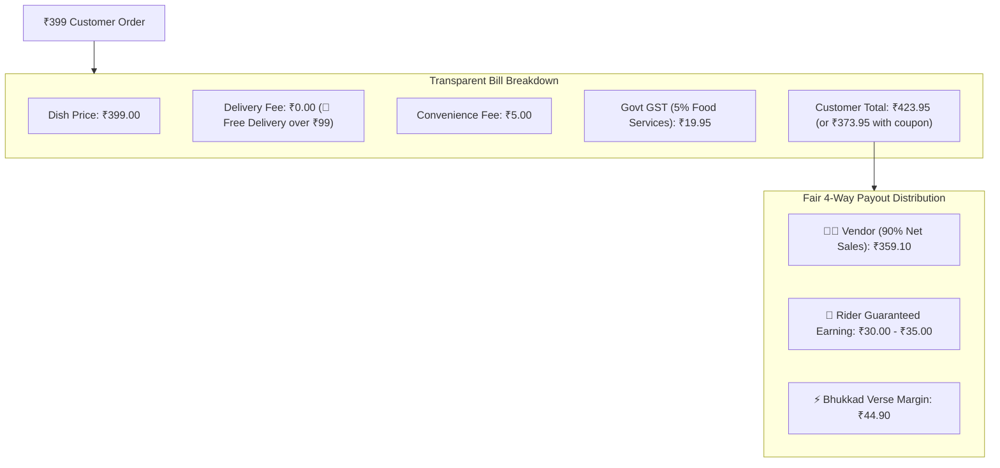

# 🍲 BHUKKAD VERSE — "YOUR CRAVINGS. YOUR UNIVERSE."

> **A Next-Generation, Autonomous Hyperlocal Food Marketplace** bridging verified street food carts, artisanal neighborhood cloud kitchens, and luxury fine-dining dining rooms with transparent pricing, cinematic video reels, and complete vendor self-governance.


> 📖 **Comprehensive Technical Report & Architecture:** Check out the complete [PROJECT_REPORT.md](PROJECT_REPORT.md) for full ER diagrams, lifecycle state machines, API contracts, and financial split analyses.

---

## 🌟 Overview & Elevator Pitch

Traditional food delivery aggregators burden restaurants with steep **25%–35% commissions** and surprise customers with inflated delivery fees, surge pricing, packaging markups, and hidden platform fees.

**BHUKKAD VERSE** reimagines food delivery from first principles:
1. **Zero Bill Shock & Honest Pricing:** **100% FREE Delivery** on all orders above ₹99 (saves ₹25), flat ₹5 convenience fee, and honest 5% food GST. For a ₹399 dish, the customer pays transparently ~₹420.
2. **Fair 4-Way Real-World Economics:**
   - **Customer:** Free delivery, zero surge, authentic chef-direct food.
   - **Vendor:** Retains **90% net sales** (direct bank payouts).
   - **Rider:** Guaranteed ₹30–₹35 delivery earnings.
   - **Platform:** Sustainable ₹44.90 net margin per order pool.
3. **Theatrical Cinematic User Experience:**
   - Velvet entrance rolling shutter with looping high-def culinary ambiance.
   - Live 10-second background kitchen story reels with Instagram-style countdown bars.
   - Dynamic real-time continuous dish marquee with round-robin vendor interleaving.
4. **Three Curated Culinary Tiers:**
   - 🍢 **Iconic Street Food & Legendary Carts** (Affordable, hygienic, nostalgic).
   - 👑 **Luxury Fine Dining & Heritage Palaces** (Slow-dum biryanis, earthen handis, truffle recipes).
   - 🍳 **Fresh Neighborhood Cloud Kitchens** (Daily comfort meals, whole spices, sanitized).
5. **Autonomous Portals:** Dedicated vendor dashboards with menu builders, operating schedules, ticket resolution, and video uploads from device or online links.

---

## 🏗️ System Architecture



---

## 🔄 User Role & Workflow Matrix



---

## 💰 Honest Pricing & 4-Way Economic Model



---

## 🚀 Quick Start Guide (Clone & Run Locally)

Follow these steps to run the entire stack on your local machine:

### 1. Prerequisites
- **Node.js**: `v18.17+` or `v20+`
- **Python**: `3.10+` or `3.11+`
- **Git**

---

### 2. Clone Repository
```bash
git clone https://github.com/your-username/bhukkad-verse.git
cd bhukkad-verse
```

---

### 3. Backend Setup (Django REST Framework)

```bash
# Navigate to backend directory
cd backend

# Create virtual environment
python -m venv venv

# Activate virtual environment
# Windows (PowerShell):
.\venv\Scripts\Activate.ps1
# Windows (CMD):
.\venv\Scripts\activate.bat
# Linux / macOS:
source venv/bin/activate

# Install dependencies
pip install -r requirements.txt

# Run database migrations
python manage.py migrate

# (Optional) Seed initial demo categories and dishes if starting with empty DB:
python seed_phase4_menu.py

# Start Django Development Server (Port 8000)
python manage.py runserver 127.0.0.1:8000
```
> The API will be available at: `http://127.0.0.1:8000/api/`

---

### 4. Frontend Setup (Next.js 14 + Tailwind v4)

Open a new terminal window:
```bash
# Navigate to frontend directory
cd frontend

# Install npm dependencies
npm install

# Start Next.js Development Server (Port 3000)
npm run dev
```
> Open your browser at: `http://localhost:3000`

---

## 🔐 Pre-Seeded Demo Credentials

The included pre-seeded database contains verified accounts for instant evaluation:

| Role | Username / Login | Password | Capabilities & Access |
| :--- | :--- | :--- | :--- |
| **Platform Super Admin** | `admin@1234` | `admin123` | Full access to `/admin` CMS, Curtain, Hero, About Us, Financials, Audits. |
| **Street Food Vendor** | `vendor_street` | `vendor123` | Dashboard access for *Chandu Halwai & Street Chaat* (Samosas, Chaat, Reels). |
| **Luxury Dining Vendor** | `vendor_luxury` | `vendor123` | Dashboard access for *The Royal Saffron Luxury Palace* (Dum Biryani, Dal Makhani). |
| **Cloud Kitchen Vendor** | `chef_vikram` | `vendor123` | Autonomous dashboard for neighborhood cloud kitchen. |

---

## 📂 Project Directory Structure

```text
pp2/
├── backend/                       # Django 5 REST Framework Monolith
│   ├── apps/
│   │   ├── authentication/        # Custom User, JWT Auth, Role RBAC
│   │   ├── core/                  # CMS Settings, Video Reels, Reviews, Coupons
│   │   ├── shops/                 # Kitchen profiles, 3 Tiers, Operating Hours
│   │   ├── products/              # Dishes, Variants, Addons, Proximity Search
│   │   ├── orders/                # Cart calculation, Orders, Commissions
│   │   └── customers/             # Addresses, Support Tickets
│   ├── bhukkadverse/              # Django Settings, ASGI/WSGI, Root URLs
│   ├── media/                     # User-uploaded videos, logos, dishes
│   ├── db.sqlite3                 # Pre-seeded database
│   ├── manage.py
│   └── requirements.txt
│
├── frontend/                      # Next.js 14 App Router + Tailwind v4
│   ├── src/
│   │   ├── app/                   # App Router Pages
│   │   │   ├── page.tsx           # Homepage (Curtain, Hero, Marquee, Reels)
│   │   │   ├── admin/page.tsx     # Super Admin CMS Dashboard
│   │   │   ├── vendor/dashboard/  # Kitchen Self-Service Portal
│   │   │   ├── shops/             # Discovery & Kitchen Storefronts
│   │   │   ├── cart/              # Transparent Checkout & Bill Breakdown
│   │   │   └── about/             # Dynamic About Us Story & Pillars
│   │   ├── components/            # Reusable UI & Layout Components
│   │   │   ├── home/              # EntranceShutter, HeroSection, VideoSlider, DishesMarquee
│   │   │   ├── brand/             # Official 3D Crest, Badges & Logo Mark
│   │   │   └── layout/            # Navbar with GPS Pill, Footer
│   │   ├── context/               # AuthContext, CartContext, LocationContext
│   │   └── lib/                   # API Client, Design Tokens, Utilities
│   ├── public/
│   │   └── brand/                 # High-res logos, mascot, local video loops
│   ├── package.json
│   └── tailwind.config.ts
│
├── .gitignore
├── README.md                      # Primary GitHub Presentation (This file)
├── PROJECT_REPORT.md              # Detailed Comprehensive Technical Report
└── PRODUCTION_READINESS_AUDIT.md  # Verification & Security Audit Checklist
```

---

## 🎯 Key Feature Highlights

### 1. Entrance Rolling Shutter Ambiance
* Full-screen cinematic entrance curtain with looping HD video background.
* Interactive swipe/wheel gesture: smooth progressive roll-up revealing the storefront.
* Quick skip button: `Explore Kitchens ✕`.

### 2. Sizzling Kitchen Video Stories
* 10-second automatic reel slider featuring authentic dish preparation.
* Instagram-style animated countdown bars.
* Direct action button linking the reel to the dish for one-tap cart addition.
* Admin and Vendors can upload videos from device (`.mp4`, `.webm`) or provide online URLs.

### 3. Continuous Dishes Marquee
* Infinite running conveyor slider displaying real-time dishes from partner kitchens.
* Fair round-robin interleaving algorithm ensuring equal visibility across all vendors.
* Automatic background polling (every 25s) so newly added dishes appear live without reload.

### 4. Dynamic Platform CMS
* Complete front-end customization from `/admin`:
  - Hero primary & highlight headlines, subtitles, and badges.
  - 3D Mascot artwork upload from device or URL.
  - About Us story, pillars, and developer spotlight.
  - Curtain video, tagline, quote, and emergency notice banner.

---

## 🛠️ Technology Stack

| Layer | Technologies Used |
| :--- | :--- |
| **Frontend Framework** | Next.js 14 (App Router, Server & Client Components) |
| **Language** | TypeScript 5.0 (Strict mode, zero `any` leaks) |
| **Styling & Design** | Tailwind CSS v4, Lucide React Icons |
| **Backend Framework** | Python 3.10+, Django 5.0, Django REST Framework |
| **Authentication** | SimpleJWT (JSON Web Tokens), Cookie/Bearer support |
| **Geospatial Calculation**| Haversine Spherical Distance Formula |
| **Storage & Media** | Multipart Chunked Streaming, Local Media Engine |
| **State Management** | React Context (Auth, Cart, Location) |

---

## 👨‍💻 Author & Credits

Designed, architected, and engineered with passion by **Ayush Saxena**.

* **Brand Motto:** *"YOUR CRAVINGS. YOUR UNIVERSE."*
* **Platform:** BHUKKAD VERSE
* **License:** MIT License (Open for evaluation, cloning, and community forks)

